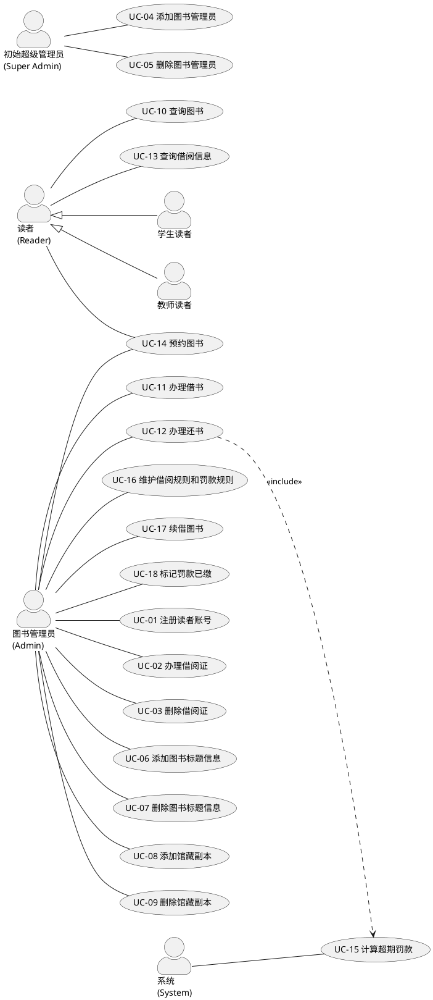

# 用例文档：图书管理系统

> **状态**：草稿（未经人工审查）
> **说明**：本内容由 Agent 生成，未经人工审查，不得直接作为实现依据。
> **依据**：`specs/02-requirements.md`（功能需求 FR-001~018、业务规则 BR-001~016）
> **关联**：`specs/00-project-brief.md`、`specs/01-clarifying-questions.md`、`specs/constitution.md`

---

## 1. 参与者识别

### 1.1 参与者清单

| 编号 | 参与者 | 类型 | 说明 |
| --- | --- | --- | --- |
| AC-01 | 读者（Reader） | 抽象父类（人类） | 拥有借阅资格的用户，是学生读者与教师读者的抽象父类，具备读者编号、姓名、联系方式、账号、借阅证、借阅列表等属性。 |
| AC-02 | 学生读者（StudentReader） | 读者子类（人类） | 细分为本科生、研究生、博士生、专科生，借阅限额与期限差异化。 |
| AC-03 | 教师读者（TeacherReader） | 读者子类（人类） | 即教师，借阅上限最高（15 本 / 90 天），预约优先级最高。 |
| AC-04 | 图书管理员（Admin） | 人类 | 拥有全部管理权限：管理账号、维护图书与副本、办理借还、处理预约、标记罚款已缴。 |
| AC-05 | 初始超级管理员（Super Admin） | 人类 | 系统初始化内置的默认管理员账号，负责创建/停用其他管理员账号。 |
| AC-06 | 系统（System） | 自动参与者 | 承担自动计算超期罚款、发送站内预约通知、自动取消过期预约等非人工行为。 |

> **口径说明**：关于"系统管理员"与"图书管理员"的角色划分存在待确认冲突（见 `02-requirements.md` P-02）。本文档暂按"单一图书管理员角色（拥有全部权限）+ 初始超级管理员"表述，与需求规格保持一致。

### 1.2 参与者说明

- **读者类参与者**（AC-01~03）在借阅/归还/续借场景中为"被服务方"（出示借阅证、提供书名），不直接操作系统办理柜台业务（见待确认问题 P-05）；仅在"预约图书"（发起预约）、"查询借阅信息"（查本人）、"查询图书"等场景中直接操作系统。
- **图书管理员**（AC-04）是绝大多数办理类用例的主要参与者。
- **系统**（AC-06）作为自动参与者，负责规则计算（罚款）与异步通知（预约），不涉及人工操作。

---

## 2. 用例清单

| 用例编号 | 用例名称 | 主要参与者 | 关联需求编号 |
| --- | --- | --- | --- |
| UC-01 | 注册读者账号 | 图书管理员 | FR-001 |
| UC-02 | 办理借阅证 | 图书管理员 | FR-002、BR-006、BR-015 |
| UC-03 | 删除借阅证 | 图书管理员 | FR-003、BR-006 |
| UC-04 | 添加图书管理员 | 初始超级管理员 | FR-004 |
| UC-05 | 删除图书管理员 | 初始超级管理员 | FR-005 |
| UC-06 | 添加图书标题信息 | 图书管理员 | FR-006 |
| UC-07 | 删除图书标题信息 | 图书管理员 | FR-007 |
| UC-08 | 添加馆藏副本 | 图书管理员 | FR-008 |
| UC-09 | 删除馆藏副本 | 图书管理员 | FR-009 |
| UC-10 | 查询图书 | 读者 / 图书管理员 | FR-010 |
| UC-11 | 办理借书 | 图书管理员 | FR-011、BR-001~007 |
| UC-12 | 办理还书 | 图书管理员 | FR-012、BR-008~010 |
| UC-13 | 查询借阅信息 | 读者 / 图书管理员 | FR-013 |
| UC-14 | 预约图书 | 读者（发起）/ 图书管理员（处理分配） | FR-014、BR-011~014 |
| UC-15 | 计算超期罚款 | 系统（自动） | FR-015、BR-008~010 |
| UC-16 | 维护借阅规则和罚款规则 | 图书管理员 | FR-016 |
| UC-17 | 续借图书 | 图书管理员 | FR-017、BR-002~003 |
| UC-18 | 标记罚款已缴 | 图书管理员 | FR-018、BR-010 |

### 2.1 用例图（PlantUML）

---

## 3. 用例详细描述

### 3.1 UC-01 注册读者账号

- **用例编号**：UC-01
- **用例名称**：注册读者账号
- **主要参与者**：图书管理员
- **次要参与者**：读者（提供姓名、学号/工号、身份类型、联系方式）
- **前置条件**：图书管理员已登录且具备管理权限。
- **后置条件**：系统创建读者账号，状态为"待激活"，等待管理员审核。
- **基本事件流**：
  1. 图书管理员进入"注册读者账号"页面，录入姓名、学号/工号、身份类型（本科生/研究生/博士生/专科生/教师）、联系方式（手机或邮箱）。
  2. 系统校验必填信息完整且学号/工号未重复。
  3. 系统创建读者账号，状态置为"待激活"，返回创建成功。
  4. 图书管理员对"待激活"账号执行审核通过。
  5. 系统将账号状态置为"已激活"，读者获得借阅资格。
- **备选事件流**：无。
- **异常事件流**：
  1. 缺少任一必填信息 → 系统拒绝创建，提示具体缺失项。
  2. 学号/工号已存在 → 系统拒绝，提示"已存在该学号/工号"。
  3. 读者或未登录用户尝试注册 → 系统拒绝（越权）。
- **关联需求编号**：FR-001

---

### 3.2 UC-02 办理借阅证（重点用例）

- **用例编号**：UC-02
- **用例名称**：办理借阅证
- **主要参与者**：图书管理员
- **次要参与者**：读者（出示已激活账号信息）
- **前置条件**：
  1. 图书管理员已登录且具备管理权限。
  2. 读者账号已激活（状态为"已激活"）。
  3. 读者尚无有效借阅证（账号 ↔ 读者 ↔ 借阅证为一对一关系）。
- **后置条件**：系统生成唯一借阅证号，借阅证状态为"有效"，与读者一对一关联。
- **基本事件流**：
  1. 图书管理员进入"办理借阅证"页面，输入读者编号或学号/工号。
  2. 系统检索该读者，验证其账号存在且已激活。
  3. 系统验证该读者当前尚无有效借阅证。
  4. 系统生成唯一借阅证号。
  5. 系统创建借阅证记录，状态置为"有效"，关联该读者。
  6. 系统显示办理成功，返回借阅证号。
- **备选事件流**：
  1. 读者为毕业生或离职教师（在校/在职状态为"否"）→ 系统仍可办理，但借阅证状态受后续失效规则约束（见 BR-006）。
- **异常事件流**：
  1. 读者账号不存在 → 系统拒绝，提示"读者不存在"。
  2. 账号为"待激活"或无效 → 系统拒绝，提示"需先激活账号"。
  3. 读者已有有效借阅证 → 系统拒绝，提示"该读者已有借阅证"。
  4. 非管理员执行办理 → 系统拒绝（越权）。
- **关联需求编号**：FR-002、BR-006、BR-015

> **待确认**：P-01 指出"办理借阅证与注册账号的关系"未明确（是否独立用例、借阅证是否有有效期及续期方式）。本文档暂按独立用例描述。

---

### 3.3 UC-03 删除借阅证

- **用例编号**：UC-03
- **用例名称**：删除借阅证
- **主要参与者**：图书管理员
- **次要参与者**：无
- **前置条件**：图书管理员已登录且具备管理权限。
- **后置条件**：借阅证状态置为"已失效"，读者历史数据保留，不删除读者数据。
- **基本事件流**：
  1. 图书管理员输入读者编号或借阅证号，定位借阅证。
  2. 系统校验该读者无未还图书且无未缴罚款。
  3. 系统将借阅证状态置为"已失效"，保留读者历史数据。
  4. 系统显示删除（注销）成功。
- **备选事件流**：无。
- **异常事件流**：
  1. 读者存在未还图书或未缴罚款 → 系统拒绝，提示"需先处理未还图书或欠费"。
  2. 非管理员执行 → 系统拒绝（越权）。
- **关联需求编号**：FR-003、BR-006

---

### 3.4 UC-04 添加图书管理员

- **用例编号**：UC-04
- **用例名称**：添加图书管理员
- **主要参与者**：初始超级管理员
- **次要参与者**：无
- **前置条件**：初始超级管理员已登录。
- **后置条件**：系统创建图书管理员账号，该账号可登录并执行管理操作。
- **基本事件流**：
  1. 超级管理员进入"添加图书管理员"页面，录入账号信息。
  2. 系统校验账号标识不重复。
  3. 系统创建管理员账号，返回成功。
- **备选事件流**：无。
- **异常事件流**：
  1. 账号标识重复 → 系统拒绝创建。
  2. 非超级管理员执行 → 系统拒绝（越权）。
- **关联需求编号**：FR-004

---

### 3.5 UC-05 删除图书管理员

- **用例编号**：UC-05
- **用例名称**：删除图书管理员
- **主要参与者**：初始超级管理员
- **次要参与者**：无
- **前置条件**：初始超级管理员已登录。
- **后置条件**：目标管理员账号被停用，无法再登录或执行任何管理操作。
- **基本事件流**：
  1. 超级管理员定位目标管理员账号并执行停用。
  2. 系统校验该账号不是最后一个超级管理员。
  3. 系统停用该账号，返回成功。
- **备选事件流**：无。
- **异常事件流**：
  1. 尝试停用最后一个超级管理员（默认管理员）→ 系统拒绝，防止系统失去唯一管理员入口。
  2. 非超级管理员执行 → 系统拒绝（越权）。
- **关联需求编号**：FR-005

---

### 3.6 UC-06 添加图书标题信息

- **用例编号**：UC-06
- **用例名称**：添加图书标题信息
- **主要参与者**：图书管理员
- **次要参与者**：无
- **前置条件**：图书管理员已登录且具备管理权限。
- **后置条件**：系统创建图书标题记录。
- **基本事件流**：
  1. 图书管理员录入题名、作者、ISBN、分类号、出版社、出版年。
  2. 系统校验题名、ISBN 为必填且 ISBN 不重复。
  3. 系统创建标题记录，返回成功。
- **备选事件流**：无。
- **异常事件流**：
  1. ISBN 已存在 → 系统拒绝，提示"该 ISBN 已存在"。
  2. 缺少必填字段（题名/ISBN）→ 系统拒绝，提示缺失字段。
- **关联需求编号**：FR-006

---

### 3.7 UC-07 删除图书标题信息

- **用例编号**：UC-07
- **用例名称**：删除图书标题信息
- **主要参与者**：图书管理员
- **次要参与者**：无
- **前置条件**：图书管理员已登录且具备管理权限。
- **后置条件**：标题记录被删除，按该标题查询不再返回。
- **基本事件流**：
  1. 图书管理员定位目标标题并执行删除。
  2. 系统校验该标题无关联馆藏副本。
  3. 系统删除标题记录，返回成功。
- **备选事件流**：无。
- **异常事件流**：
  1. 标题存在关联馆藏副本（在架/借出/预约保留等任意状态）→ 系统拒绝，提示"需先处理关联副本"。
- **关联需求编号**：FR-007

---

### 3.8 UC-08 添加馆藏副本

- **用例编号**：UC-08
- **用例名称**：添加馆藏副本
- **主要参与者**：图书管理员
- **次要参与者**：无
- **前置条件**：图书管理员已登录，目标标题已存在。
- **后置条件**：系统创建馆藏副本，副本号唯一，状态为"在架"。
- **基本事件流**：
  1. 图书管理员选择目标标题，录入副本号、馆藏位置。
  2. 系统校验标题存在且副本号在该标题下不重复。
  3. 系统创建副本，初始状态为"在架"，返回成功。
- **备选事件流**：无。
- **异常事件流**：
  1. 标题不存在 → 系统拒绝，提示"标题不存在"。
  2. 副本号在同一标题下重复 → 系统拒绝，提示"副本号重复"。
- **关联需求编号**：FR-008

---

### 3.9 UC-09 删除馆藏副本

- **用例编号**：UC-09
- **用例名称**：删除馆藏副本
- **主要参与者**：图书管理员
- **次要参与者**：无
- **前置条件**：图书管理员已登录且具备管理权限。
- **后置条件**：副本被删除，按副本号查询不再返回。
- **基本事件流**：
  1. 图书管理员定位目标副本并执行删除。
  2. 系统校验副本状态为"在架"或"维护中"且无关联借阅记录。
  3. 系统删除副本，返回成功。
- **备选事件流**：无。
- **异常事件流**：
  1. 副本状态为"借出"或"预约保留"→ 系统拒绝删除。
- **关联需求编号**：FR-009

---

### 3.10 UC-10 查询图书

- **用例编号**：UC-10
- **用例名称**：查询图书
- **主要参与者**：读者、图书管理员
- **次要参与者**：无
- **前置条件**：用户已登录（读者或管理员）。
- **后置条件**：返回匹配的标题列表及各副本可借状态。
- **基本事件流**：
  1. 用户按题名、作者、ISBN、分类号等条件发起查询。
  2. 系统按条件模糊匹配标题，返回标题列表及各副本状态（在架/借出/预约保留/维护中/丢失）。
- **备选事件流**：无匹配结果 → 返回空列表。
- **异常事件流**：未登录用户查询 → 视权限策略拒绝（RBAC）。
- **关联需求编号**：FR-010

---

### 3.11 UC-11 办理借书（重点用例）

- **用例编号**：UC-11
- **用例名称**：办理借书
- **主要参与者**：图书管理员
- **次要参与者**：读者（出示借阅证）、系统（自动计算应还日期）
- **前置条件**：
  1. 图书管理员已登录且具备管理权限。
  2. 读者持有效借阅证到馆办理。
- **后置条件**：借阅成功时，副本状态置为"借出"，读者账户更新（借阅数 +1、借阅列表增加该副本、应还日期确定）。
- **基本事件流**：
  1. 图书管理员输入借阅证号。
  2. 系统验证借阅证是否存在且有效。
  3. 系统检查读者当前借阅数量是否达到上限。
  4. 系统检查读者是否存在超期未还图书。
  5. 系统检查读者是否存在未缴罚款。
  6. 系统显示读者信息。
  7. 图书管理员输入图书副本信息。
  8. 系统验证图书是否为本馆藏书且可借（副本状态为"在架"）。
  9. 系统创建借阅记录，按读者类型与借出物类型计算应还日期。
  10. 系统更新图书副本状态为"借出"，更新读者账户（借阅数 +1、借阅列表增加该副本）。
  11. 系统显示借阅成功。
- **备选事件流**：
  1. 读者已借同一标题的另一副本 → 系统在步骤 8 校验时拒绝（同标题限借 1 本，BR-005）。
  2. 借阅外文图书 / 杂志 / 论文 → 步骤 9 按 BR-003 计算限额与期限（外文减半、杂志 7 天不计入图书限额、论文 3 天不可续借）。
- **异常事件流**：
  1. 借阅证不存在或已失效 → 系统拒绝，提示"借阅证无效"（对应步骤 2）。
  2. 当前借阅数已达上限 → 系统拒绝，提示"已达借阅上限"（对应步骤 3）。
  3. 读者存在超期未还 → 系统拒绝，提示"存在超期未还"（对应步骤 4）。
  4. 读者存在未缴罚款 → 系统拒绝，提示"存在未缴罚款"（对应步骤 5）。
  5. 目标副本已被他人借出或发生并发竞争 → 系统拒绝，提示"副本不可借"（对应步骤 8）。
  6. 非管理员办理借书 → 系统拒绝（越权）。
- **关联需求编号**：FR-011、BR-001、BR-002、BR-003、BR-004、BR-005、BR-006、BR-007

> **待确认**：P-03 指出杂志/论文的借阅数量是否另有独立上限未明确，本文档暂按"仅受短期期限约束"表述。

---

### 3.12 UC-12 办理还书（重点用例）

- **用例编号**：UC-12
- **用例名称**：办理还书
- **主要参与者**：图书管理员
- **次要参与者**：读者（出示借阅证或所还图书）、系统（自动判断超期并计算罚款）
- **前置条件**：
  1. 图书管理员已登录且具备管理权限。
  2. 读者持有该副本的有效借阅记录（副本状态为"借出"）。
- **后置条件**：副本状态置为"在架"；借阅记录标记已归还；读者借阅数减一；若超期则生成罚款记录记入读者欠费（挂账）。
- **基本事件流**：
  1. 图书管理员输入借阅证号或副本号。
  2. 系统验证借阅证有效，显示该读者的借阅列表。
  3. 图书管理员选择要归还的副本。
  4. 系统记录实际归还日期。
  5. 系统判断是否超期（实际归还日期是否晚于应还日期）。
  6. 系统将副本状态置为"在架"，借阅记录标记为已归还，读者借阅数减一。
  7. 系统更新读者账户，显示归还结果。
- **备选事件流**：
  1. 超期归还 → 步骤 5 判断超期后，系统按规则计算罚款并记入读者欠费（挂账，见 UC-15），归还仍完成。
  2. 归还标题存在等待中的预约 → 归还完成后触发预约分配（见 UC-14 备选流程）。
- **异常事件流**：
  1. 借阅证无效 → 系统拒绝，提示"借阅证无效"。
  2. 所选副本不属于该读者 → 系统拒绝，提示"副本不匹配"。
  3. 副本状态异常（非"借出"）→ 系统拒绝，提示"副本不可归还"。
- **关联需求编号**：FR-012、BR-008、BR-009、BR-010

---

### 3.13 UC-13 查询借阅信息

- **用例编号**：UC-13
- **用例名称**：查询借阅信息
- **主要参与者**：读者、图书管理员
- **次要参与者**：无
- **前置条件**：用户已登录。
- **后置条件**：返回借阅列表、借阅历史、罚款、预约状态等信息。
- **基本事件流**：
  1. 读者查询本人借阅信息 → 返回当前借阅列表、借阅历史、未缴罚款、预约状态。
  2. 管理员查询任意读者 → 返回该读者完整的当前借阅、历史借阅、罚款、预约信息。
- **备选事件流**：无。
- **异常事件流**：读者查询其他读者信息 → 系统拒绝（越权）。
- **关联需求编号**：FR-013

---

### 3.14 UC-14 预约图书（重点用例）

- **用例编号**：UC-14
- **用例名称**：预约图书
- **主要参与者**：读者（发起预约）、图书管理员（处理分配）
- **次要参与者**：系统（自动发送站内消息、自动取消过期预约）
- **前置条件**：
  1. 读者已登录。
  2. 目标标题所有副本均被借出。
- **后置条件**：预约成功时生成预约记录（状态"等待中"），进入预约队列；副本释放分配后状态置为"预约保留"并通知读者。
- **基本事件流（读者发起预约）**：
  1. 读者查询图书，发现某标题所有副本均被借出。
  2. 读者发起预约。
  3. 系统验证读者预约资格：未借该标题、未达预约上限（3 个）、无未缴罚款。
  4. 系统验证该标题所有副本均被借出（可预约）。
  5. 系统创建预约记录，状态置为"等待中"，进入预约队列。
  6. 系统显示预约成功。
- **备选事件流（副本释放后的分配与通知）**：
  1. 当某副本归还时，系统检测该标题是否存在"等待中"的预约。
  2. 系统按优先级（教师 > 博士生 > 研究生 > 本科生 > 专科生）分配，同级按先到先得。
  3. 系统将副本状态置为"预约保留"，向该读者发送站内消息。
  4. 读者在 7 天保留期内取书；过期未取，系统自动取消预约（状态置为"已过期"），不记违约。
- **异常事件流**：
  1. 读者已借该标题 → 系统拒绝预约，提示"已借该标题不可预约"。
  2. 读者预约数已达上限（3 个）→ 系统拒绝，提示"预约数量已达上限"。
  3. 读者存在未缴罚款 → 系统拒绝，提示"存在未缴罚款"。
  4. 标题存在"在架"副本 → 系统拒绝预约（不满足预约触发条件）。
  5. 非读者本人预约 / 非管理员处理分配 → 系统拒绝（越权）。
- **关联需求编号**：FR-014、BR-011、BR-012、BR-013、BR-014

> **待确认**：P-07 指出预约成功后读者在等待期间产生欠费，其已有预约是否失效或降级未明确，本文档暂未对该情形作约束。

---

### 3.15 UC-15 计算超期罚款（重点用例）

- **用例编号**：UC-15
- **用例名称**：计算超期罚款
- **主要参与者**：系统（自动）
- **次要参与者**：无
- **前置条件**：存在超期借阅记录（实际归还日期晚于应还日期，或当前日期晚于应还日期且未还）。
- **后置条件**：生成罚款记录，状态为"未缴"，记入读者欠费。
- **基本事件流**：
  1. 系统在归还流程中（或定时任务中）识别到超期借阅记录。
  2. 系统计算超期天数 N = 实际归还日期 − 应还日期。
  3. 系统查询借出物类型，确定罚款单价（中文图书 0.1 元/天、外文图书 0.2 元/天、杂志 0.5 元/天、论文 1.0 元/天）。
  4. 系统计算罚款金额 = 单价 × N。
  5. 系统判断罚款金额是否超过单册上限 20 元，超过则按 20 元封顶。
  6. 系统生成罚款记录，状态置为"未缴"，记入读者欠费。
- **备选事件流**：
  1. 未超期（N ≤ 0）→ 罚款为 0，不生成罚款记录。
- **异常事件流**：
  1. 罚款累计达到单册上限（20 元）→ 按 20 元封顶，不再累加，不产生滞纳金或复利。
- **关联需求编号**：FR-015、BR-008、BR-009、BR-010

> **说明**：本用例为"办理还书"（UC-12）与"维护规则"（UC-16）的公共子流程，由系统自动触发，无需人工操作。

---

### 3.16 UC-16 维护借阅规则和罚款规则

- **用例编号**：UC-16
- **用例名称**：维护借阅规则和罚款规则
- **主要参与者**：图书管理员
- **次要参与者**：无
- **前置条件**：图书管理员已登录且具备管理权限。
- **后置条件**：规则更新保存，新发生的借阅/罚款按新规则执行。
- **基本事件流**：
  1. 图书管理员进入规则维护页面，修改读者类型借阅上限与期限、借出物类型限制、罚款单价与上限。
  2. 系统校验输入值合法（非负数等）。
  3. 系统保存规则，返回成功。
- **备选事件流**：无。
- **异常事件流**：
  1. 输入非法值（负数上限、负数单价）→ 系统拒绝保存并提示。
  2. 非管理员执行维护 → 系统拒绝（越权）。
- **关联需求编号**：FR-016

---

### 3.17 UC-17 续借图书

- **用例编号**：UC-17
- **用例名称**：续借图书
- **主要参与者**：图书管理员
- **次要参与者**：读者（提出续借申请）
- **前置条件**：读者存在在借图书，且满足续借条件（未超期、无欠费、该副本未续借过）。
- **后置条件**：续借成功时，应还日期顺延原期限。
- **基本事件流**：
  1. 图书管理员输入借阅证号与副本号，发起续借。
  2. 系统校验未超期、无欠费、该副本未续借过。
  3. 系统将应还日期顺延一次原期限，标记已续借，返回成功。
- **备选事件流**：无。
- **异常事件流**：
  1. 该副本已续借过 1 次 → 系统拒绝，提示"不可再次续借"。
  2. 借出物为论文 → 系统拒绝，提示"论文不可续借"。
  3. 读者存在超期未还或未缴罚款 → 系统拒绝续借。
- **关联需求编号**：FR-017、BR-002、BR-003

> **待确认**：P-04 指出续借是否需重新校验超期/欠费及应还日期起算方式未明确，本文档暂按"顺延原期限、需通过前置校验"表述。

---

### 3.18 UC-18 标记罚款已缴

- **用例编号**：UC-18
- **用例名称**：标记罚款已缴
- **主要参与者**：图书管理员
- **次要参与者**：读者（线下缴纳罚款）
- **前置条件**：读者存在未缴罚款，且已线下缴清（模拟缴费）。
- **后置条件**：读者欠费状态清零，保留缴费历史记录，恢复借阅与预约资格。
- **基本事件流**：
  1. 图书管理员对欠费读者执行"标记已缴"。
  2. 系统将欠费状态清零，记录缴纳时间，保留缴费历史。
  3. 系统显示缴费完成，读者恢复借阅与预约资格。
- **备选事件流**：无。
- **异常事件流**：非管理员执行标记 → 系统拒绝（越权）。
- **关联需求编号**：FR-018、BR-010

---

## 4. 用例与需求追溯矩阵

| 需求编号 | 对应用例 | 需求编号 | 对应用例 |
| --- | --- | --- | --- |
| FR-001 | UC-01 | FR-010 | UC-10 |
| FR-002 | UC-02 | FR-011 | UC-11 |
| FR-003 | UC-03 | FR-012 | UC-12 |
| FR-004 | UC-04 | FR-013 | UC-13 |
| FR-005 | UC-05 | FR-014 | UC-14 |
| FR-006 | UC-06 | FR-015 | UC-15 |
| FR-007 | UC-07 | FR-016 | UC-16 |
| FR-008 | UC-08 | FR-017 | UC-17 |
| FR-009 | UC-09 | FR-018 | UC-18 |