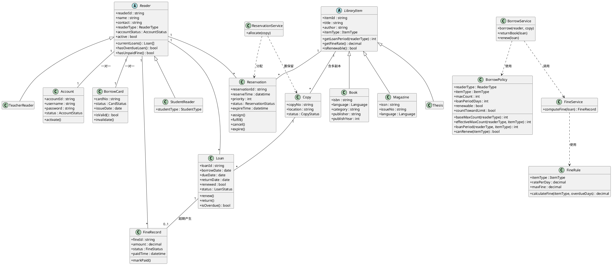

# 领域模型文档：图书管理系统

> **状态**：草稿（未经人工审查）
> **说明**：本内容由 Agent 生成，未经人工审查，不得直接作为实现依据。
> **依据**：`specs/02-requirements.md`（FR-001~018、BR-001~016）、`specs/03-use-cases.md`（UC-01~18）、`specs/constitution.md`

---

## 1. 概述与建模说明

### 1.1 文档目的

本文档从业务视角识别图书管理系统的核心领域类，描述各领域类的职责、关键属性、关键行为、约束与类间关系，作为后续类图（UML）、架构设计与编码的事实基础。领域类命名遵循英文命名规范，类间关系遵循 `constitution.md` 第 5 条（UML-as-Spec，仅使用 PlantUML 文本格式）。

### 1.2 概念映射说明

需求文档中的若干业务概念在领域模型中统一映射到以下类，便于对齐与追溯：

| 需求文档概念（`02-requirements.md`） | 领域模型类 | 说明 |
| --- | --- | --- |
| 读者（Reader，抽象父类） | `Reader`（抽象实体） | 拥有借阅资格的用户，抽象父类 |
| 学生读者（StudentReader） | `StudentReader`（实体） | 细分为本科生/研究生/博士生/专科生 |
| 教师读者（TeacherReader） | `TeacherReader`（实体） | 借阅上限最高、预约优先级最高 |
| 借出物类型（中文图书/外文图书/中文杂志/外文杂志/论文） | `LibraryItem` ← `Book` / `Magazine` / `Thesis` | 借出物抽象基类及子类，配合 `language` 属性区分中/外文 |
| 图书标题（Title） | `LibraryItem` 及子类上的书目属性 | 书目信息并入借出物子类，不单列 Title |
| 馆藏副本（Copy） | `Copy`（实体） | 借出物下的具体物理册 |
| 借阅证 | `BorrowCard`（实体） | 读者借阅资格凭证，一对一 |
| 借阅记录 | `Loan`（实体） | 表达借出/归还状态 |
| 预约记录 | `Reservation`（实体） | 支持优先级 + 先到先得排队 |
| 罚款记录 | `FineRecord`（实体） | 记录罚款及缴纳状态 |
| 借阅规则（BR-001~007、BR-011~014） | `BorrowPolicy`（策略） | 读者类型 × 借出物类型 → 限额/期限 |
| 罚款规则（BR-008~009） | `FineRule`（策略） | 借出物类型 → 单价/上限 |
| 账号（Account） | `Account`（实体） | 登录凭据，与读者一对一 |

> **说明**：`LibraryItem` 同时承担需求文档中"借出物类型"（分类维度）与"标题/书目信息"（描述维度）两个角色。借出物类型通过继承层次 + `language` 属性表达，书目元数据（题名、作者、ISBN 等）作为各子类属性表达，避免引入冗余的 Title 概念。

---

## 2. 领域类总览与类型归类

| 类名 | 类型 | 说明 |
| --- | --- | --- |
| `Reader` | 抽象实体（Entity） | 读者抽象父类 |
| `StudentReader` | 实体（Entity） | 学生读者，继承 Reader |
| `TeacherReader` | 实体（Entity） | 教师读者，继承 Reader |
| `Account` | 实体（Entity） | 登录账号，与 Reader 一对一 |
| `BorrowCard` | 实体（Entity） | 借阅证 |
| `LibraryItem` | 抽象实体（Entity） | 借出物抽象基类 |
| `Book` | 实体（Entity） | 图书，继承 LibraryItem |
| `Magazine` | 实体（Entity） | 杂志，继承 LibraryItem |
| `Thesis` | 实体（Entity） | 论文，继承 LibraryItem |
| `Copy` | 实体（Entity） | 馆藏副本（物理册） |
| `Loan` | 实体（Entity） | 借阅记录 |
| `Reservation` | 实体（Entity） | 预约记录 |
| `FineRecord` | 实体（Entity） | 罚款记录 |
| `BorrowPolicy` | 策略（Policy/Strategy） | 借阅规则 |
| `FineRule` | 策略（Policy/Strategy） | 罚款规则 |
| `BorrowService` | 领域服务（Domain Service） | 借阅/归还/续借编排 |
| `FineService` | 领域服务（Domain Service） | 超期罚款计算编排 |
| `ReservationService` | 领域服务（Domain Service） | 预约分配编排 |

---

## 3. 领域类详细说明

### 3.1 读者域

#### Reader（读者，抽象实体）

- **类名**：`Reader`
- **类型**：抽象实体（Entity）
- **职责**：代表拥有借阅资格的用户，是所有读者的抽象父类，封装读者公共身份信息与借阅状态。
- **关键属性**：
  - `readerId`：读者编号（唯一标识）
  - `name`：姓名（必填）
  - `contact`：联系方式（手机或邮箱，必填）
  - `readerType`：读者类型（鉴别属性，枚举：Undergraduate / Graduate / Doctoral / JuniorCollege / Teacher）
  - `accountStatus`：账号状态（待激活 / 已激活）
  - `active`：在校/在职状态（用于判断借阅证是否应失效）
- **关键方法/行为**：
  - `currentLoans()`：返回当前在借记录列表
  - `hasOverdueLoan()`：是否存在超期未还（BR-007 前置校验）
  - `hasUnpaidFine()`：是否存在未缴罚款（BR-007 前置校验）
  - `activeReservations()`：返回进行中的预约
- **约束**：
  - 与 `Account` 一对一；与 `BorrowCard` 一对一（BR-015）
  - `readerType` 决定借阅限额与期限（BR-001），以及预约优先级（BR-013）
- **与其他类的关系**：
  - 关联 `Account`（1:1）
  - 关联 `BorrowCard`（1:1）
  - 关联 `Loan`（1:N）
  - 关联 `Reservation`（1:N）
  - 关联 `FineRecord`（1:N）
  - 泛化：`StudentReader`、`TeacherReader` 继承 `Reader`

#### StudentReader（学生读者，实体）

- **类名**：`StudentReader`
- **类型**：实体（Entity），继承 `Reader`
- **职责**：代表学生读者，细分为本科生、研究生、博士生、专科生，借阅限额与期限差异化。
- **关键属性**：
  - `studentType`：学生类别（枚举：Undergraduate / Graduate / Doctoral / JuniorCollege）
  - 继承 `Reader` 的全部属性
- **关键方法/行为**：
  - 继承 `Reader` 行为；借阅限额与期限由 `studentType` 经 `BorrowPolicy` 决定（BR-001）
- **约束**：
  - `studentType` 取值决定可借上限（专科生 3、本科生 5、研究生 8、博士生 10）与期限（30/30/60/60 天）
- **与其他类的关系**：继承 `Reader`（泛化）

#### TeacherReader（教师读者，实体）

- **类名**：`TeacherReader`
- **类型**：实体（Entity），继承 `Reader`
- **职责**：代表教师读者，借阅上限最高（15 本/90 天），预约优先级最高（BR-013）。
- **关键属性**：
  - 继承 `Reader` 的全部属性（`readerType` = Teacher）
- **关键方法/行为**：
  - 继承 `Reader` 行为；预约优先级为最高
- **约束**：
  - 可借上限 15 本、期限 90 天（BR-001）
- **与其他类的关系**：继承 `Reader`（泛化）

#### Account（账号，实体）

- **类名**：`Account`
- **类型**：实体（Entity）
- **职责**：读者的登录凭据，承载认证信息。
- **关键属性**：
  - `accountId`：账号标识（唯一）
  - `username`：登录名（唯一）
  - `password`：密码（加密存储，NFR-003）
  - `status`：账号状态（待激活 / 已激活 / 已停用）
- **关键方法/行为**：
  - `activate()`：审核通过，置为已激活（FR-001）
- **约束**：
  - 与 `Reader` 一对一（BR-015）
- **与其他类的关系**：关联 `Reader`（1:1）

#### BorrowCard（借阅证，实体）

- **类名**：`BorrowCard`
- **类型**：实体（Entity）
- **职责**：读者借阅资格的凭证，与读者一对一，状态可为有效或已失效。
- **关键属性**：
  - `cardNo`：借阅证号（唯一，办理时生成）
  - `status`：状态（枚举：Active 有效 / Invalid 已失效）
  - `issueDate`：办理日期
- **关键方法/行为**：
  - `isValid()`：判断状态是否为"有效"
  - `invalidate()`：置为"已失效"（注销/毕业/离职触发，BR-006）
- **约束**：
  - 与 `Reader` 一对一（BR-015）
  - 状态仅取 Active / Invalid
  - 注销需满足无未还图书且无未缴罚款（FR-003）
- **与其他类的关系**：关联 `Reader`（1:1）

---

### 3.2 借出物域

#### LibraryItem（借出物，抽象实体）

- **类名**：`LibraryItem`
- **类型**：抽象实体（Entity）
- **职责**：代表可被借出的馆藏物的抽象概念，对应"借出物类型"维度，封装书目公共属性。
- **关键属性**：
  - `itemId`：借出物标识
  - `title`：题名（必填）
  - `author`：作者（可选）
  - `itemType`：借出物类型（鉴别属性，由子类决定：Book / Magazine / Thesis）
- **关键方法/行为**：
  - `getLoanPeriod(readerType)`：获取借阅期限（委托 `BorrowPolicy`）
  - `getFineRate()`：获取罚款单价（委托 `FineRule`）
  - `isRenewable()`：判断是否可续借
- **约束**：
  - 题名必填
  - 子类决定借阅期限、罚款单价、续借规则（BR-003、BR-008）
- **与其他类的关系**：
  - 泛化：`Book`、`Magazine`、`Thesis` 继承 `LibraryItem`
  - 关联 `Copy`（1:N）
  - 关联 `Reservation`（1:N）

#### Book（图书，实体）

- **类名**：`Book`
- **类型**：实体（Entity），继承 `LibraryItem`
- **职责**：图书类借出物，含中文图书与外文图书。
- **关键属性**：
  - `isbn`：国际标准书号（必填、唯一）
  - `language`：语种（枚举：Chinese 中文 / Foreign 外文）
  - `category`：分类号（可选）
  - `publisher`：出版社（可选）
  - `publishYear`：出版年（可选）
- **关键方法/行为**：
  - 继承 `LibraryItem` 行为
- **约束**：
  - `isbn` 必填且唯一（FR-006）
  - 外文图书数量限额减半、借阅期限减半（BR-003）
- **与其他类的关系**：继承 `LibraryItem`（泛化）

#### Magazine（杂志，实体）

- **类名**：`Magazine`
- **类型**：实体（Entity），继承 `LibraryItem`
- **职责**：杂志类借出物，含中文杂志与外文杂志。
- **关键属性**：
  - `issn`：国际标准连续出版物号（可选）
  - `issueNo`：期号（可选）
  - `language`：语种（枚举：Chinese / Foreign）
- **关键方法/行为**：
  - 继承 `LibraryItem` 行为
- **约束**：
  - 仅短期借阅 7 天，不计入图书借阅限额（BR-003）
- **与其他类的关系**：继承 `LibraryItem`（泛化）

#### Thesis（论文，实体）

- **类名**：`Thesis`
- **类型**：实体（Entity），继承 `LibraryItem`
- **职责**：论文类借出物。
- **关键属性**：
  - 学位授予单位、完成年份等（可选，视书目录入需要）
- **关键方法/行为**：
  - 继承 `LibraryItem` 行为
- **约束**：
  - 仅短期借阅 3 天，不可续借（BR-002、BR-003）
- **与其他类的关系**：继承 `LibraryItem`（泛化）

#### Copy（馆藏副本，实体）

- **类名**：`Copy`
- **类型**：实体（Entity）
- **职责**：借出物下的具体物理馆藏册，拥有独立副本号与状态。
- **关键属性**：
  - `copyNo`：副本号（同一借出物下唯一）
  - `location`：馆藏位置（可选）
  - `status`：状态（枚举：Available 在架 / Borrowed 借出 / Reserved 预约保留 / Maintenance 维护中 / Lost 丢失）
- **关键方法/行为**：
  - 状态流转：在架 → 借出 → 在架（归还）；在架 → 预约保留 → 借出（预约取书）
- **约束**：
  - 副本号在同一借出物下唯一（FR-008）
  - 状态仅取枚举值
  - 删除需状态为"在架/维护中"且无关联借阅记录（FR-009）
- **与其他类的关系**：
  - 关联 `LibraryItem`（N:1）
  - 关联 `Loan`（1:N）

---

### 3.3 借阅与预约域

#### Loan（借阅记录，实体）

- **类名**：`Loan`
- **类型**：实体（Entity）
- **职责**：记录一次借阅的完整生命周期，能表达"借出"与"已归还"两种状态。
- **关键属性**：
  - `loanId`：借阅记录标识
  - `borrowDate`：借阅日期（必填）
  - `dueDate`：应还日期（按读者类型与借出物类型经 `BorrowPolicy` 计算）
  - `returnDate`：实际归还日期（归还时填写）
  - `renewed`：是否已续借（布尔，最多 1 次）
  - `status`：状态（枚举：Borrowed 借出 / Returned 已归还）
- **关键方法/行为**：
  - `renew()`：续借，`dueDate` 顺延原期限，`renewed` 置为 true（BR-002）
  - `return()`：归还，`status` 置为 Returned，记录 `returnDate`
  - `isOverdue()`：判断是否超期（`returnDate` 或当前日期 > `dueDate`）
- **约束**：
  - `borrowDate` ≤ `dueDate`
  - 续借最多 1 次，论文不可续借（BR-002）
  - 应还日期由 `BorrowPolicy` 计算（BR-001、BR-003）
- **与其他类的关系**：
  - 关联 `Reader`（N:1）
  - 关联 `Copy`（N:1）
  - 关联 `FineRecord`（1:0..1，超期归还产生罚款）

#### Reservation（预约记录，实体）

- **类名**：`Reservation`
- **类型**：实体（Entity）
- **职责**：记录读者对某借出物的预约，支持按优先级 + 先到先得排队。
- **关键属性**：
  - `reservationId`：预约标识
  - `reserveTime`：预约时间（用于同级先到先得排序）
  - `priority`：优先级（由读者类型决定：教师 > 博士生 > 研究生 > 本科生 > 专科生，BR-013）
  - `status`：状态（枚举：Waiting 等待中 / Assigned 已分配 / Fulfilled 已取书 / Cancelled 已取消 / Expired 已过期）
  - `expireTime`：保留截止时间（分配后 7 天，BR-014）
- **关键方法/行为**：
  - `reserve()`：发起预约，置为 Waiting，进入队列
  - `assign()`：分配副本，置为 Assigned，计算保留期限
  - `fulfill()`：取书，置为 Fulfilled
  - `cancel()`：取消，置为 Cancelled
  - `expire()`：保留期到期未取，置为 Expired（不记违约，BR-014）
- **约束**：
  - 每位读者同时预约上限 3 个（BR-012）
  - 已借该借出物的读者不能预约同借出物（BR-012）
  - 预约触发条件：该借出物所有副本均被借出（BR-011）
  - 保留期 7 天，过期自动取消（BR-014）
- **与其他类的关系**：
  - 关联 `Reader`（N:1）
  - 关联 `LibraryItem`（N:1）
  - 队列：同一 `LibraryItem` 的多个 `Reservation` 构成按 `priority` + `reserveTime` 排序的等待队列

---

### 3.4 罚款域

#### FineRecord（罚款记录，实体）

- **类名**：`FineRecord`
- **类型**：实体（Entity）
- **职责**：记录一次超期产生的罚款及其缴纳状态。
- **关键属性**：
  - `fineId`：罚款记录标识
  - `amount`：罚款金额（按 `FineRule` 计算，单册上限 20 元）
  - `status`：状态（枚举：Unpaid 未缴 / Paid 已缴）
  - `paidTime`：缴纳时间（标记已缴时填写）
- **关键方法/行为**：
  - `markPaid()`：标记已缴，`status` 置为 Paid，记录 `paidTime`（FR-018）
- **约束**：
  - `amount` ≤ 20 元（BR-009）
  - 存在未缴罚款时禁止借阅和预约（BR-010）
- **与其他类的关系**：
  - 关联 `Reader`（N:1）
  - 关联 `Loan`（N:1，记录罚款来源借阅）

---

### 3.5 规则与策略域

#### BorrowPolicy（借阅策略，策略）

- **类名**：`BorrowPolicy`
- **类型**：策略（Policy / Strategy）
- **职责**：封装"读者类型 × 借出物类型 → 借阅数量上限、借阅期限"及续借规则，避免规则散落在业务代码中重复硬编码（constitution 第 8 条第 3 款）。
- **关键属性**：
  - `readerType`：读者类型
  - `itemType`：借出物类型
  - `maxCount`：借阅数量上限
  - `loanPeriodDays`：借阅期限（天）
  - `renewable`：是否可续借
  - `countTowardLimit`：是否计入图书限额
- **关键方法/行为**：
  - `baseMaxCount(readerType)`：读者类型基础借阅上限（BR-001）
  - `baseLoanPeriod(readerType)`：读者类型基础期限（BR-001）
  - `effectiveMaxCount(readerType, itemType)`：最终上限（读者限额与借出物限额取较小值，BR-003、BR-004）
  - `loanPeriod(readerType, itemType)`：最终期限（外文减半、杂志固定 7 天、论文固定 3 天、其余按读者类型，BR-003）
  - `canRenew(itemType)`：是否可续借（论文不可，BR-002）
- **约束**：
  - 所有数值非负（FR-016）
  - 规则可由管理员维护，新规则只影响新发生的借阅（FR-016）
- **与其他类的关系**：被 `BorrowService` 引用；输入依赖 `Reader.readerType` 与 `LibraryItem.itemType`

#### FineRule（罚款规则，策略）

- **类名**：`FineRule`
- **类型**：策略（Policy / Strategy）
- **职责**：封装"借出物类型 → 罚款单价、单册上限"的计算规则。
- **关键属性**：
  - `itemType`：借出物类型
  - `ratePerDay`：每日单价（元/天）
  - `maxFine`：单册上限（元，默认 20）
- **关键方法/行为**：
  - `ratePerDay(itemType)`：中文图书 0.1、外文图书 0.2、杂志 0.5、论文 1.0（BR-008）
  - `calculateFine(itemType, overdueDays)`：`min(rate × overdueDays, maxFine)`（BR-008、BR-009）
- **约束**：
  - 单价、上限非负（FR-016）
  - 达到上限不再累加，无滞纳金/复利（BR-009）
- **与其他类的关系**：被 `FineService` 引用；输入依赖 `LibraryItem.itemType`

---

### 3.6 领域服务

> 领域服务用于编排跨多个实体的业务流程，自身不持有业务状态，承载"借阅前置校验""罚款计算""预约分配"等规则落位（constitution 第 8 条：业务规则必须落在业务层 Service）。

#### BorrowService（借阅服务，领域服务）

- **职责**：办理借阅、归还、续借的领域编排，执行借阅前置校验（BR-007）。
- **关键方法/行为**：
  - `borrow(reader, copy)`：校验借阅证有效、未达上限、无超期、无欠费后创建 `Loan`，副本置"借出"
  - `returnBook(loan)`：置副本"在架"，若超期则调用 `FineService` 生成罚款
  - `renew(loan)`：校验可续借后顺延 `dueDate`
- **与其他类的关系**：依赖 `BorrowPolicy`、`FineService`，操作 `Loan`、`Copy`、`BorrowCard`

#### FineService（罚款计算服务，领域服务）

- **职责**：超期罚款计算编排。
- **关键方法/行为**：
  - `computeFine(loan)`：计算超期天数，调用 `FineRule` 生成 `FineRecord`
- **与其他类的关系**：依赖 `FineRule`，生成 `FineRecord`

#### ReservationService（预约分配服务，领域服务）

- **职责**：预约分配编排。
- **关键方法/行为**：
  - `allocate(copy)`：副本释放时按优先级 + 先到先得从队列取预约，置副本"预约保留"并通知读者
- **与其他类的关系**：操作 `Reservation`、`Copy`

---

## 4. 领域类图（PlantUML）

---

## 5. 类型归类小结

### 5.1 实体（Entity）

实体具有唯一标识与生命周期，状态会随时间变化，需要持久化并保留历史：

- `Reader`（抽象）、`StudentReader`、`TeacherReader`
- `Account`、`BorrowCard`
- `LibraryItem`（抽象）、`Book`、`Magazine`、`Thesis`
- `Copy`
- `Loan`、`Reservation`、`FineRecord`

### 5.2 值对象（Value Object）

本文档未引入独立的"无标识、不可变"的值对象；`BorrowPolicy` 与 `FineRule` 虽承载规则数据，但其本质是"按类型维度查询规则并计算"的策略对象，故归类为策略而非值对象。

### 5.3 策略（Policy / Strategy）

规则配置与计算逻辑，可由管理员维护（FR-016），按"读者类型 × 借出物类型"维度查询：

- `BorrowPolicy`（借阅规则：限额、期限、续借）
- `FineRule`（罚款规则：单价、上限）

### 5.4 领域服务（Domain Service）

编排跨实体业务流程、承载业务规则落位（constitution 第 8 条），无持久化状态：

- `BorrowService`（借阅/归还/续借 + 前置校验 BR-007）
- `FineService`（超期罚款计算 BR-008~009）
- `ReservationService`（预约分配 BR-013~014）

---

## 6. 人工审查要点对照

以下逐项回应人工审查重点：

1. **领域类是否来自业务，不是数据库表的机械翻译？**
   - 是。领域类直接映射需求文档中的业务概念（读者、借阅证、借出物、副本、借阅、预约、罚款、规则），未出现按表结构拆分的"读者表/借阅表"式机械翻译。

2. **是否体现不同读者类型？**
   - 是。通过 `Reader` ← `StudentReader` / `TeacherReader` 泛化体现，`StudentReader.studentType` 进一步细分本科生/研究生/博士生/专科生，教师单独作为 `TeacherReader`。

3. **是否体现不同借出物类型？**
   - 是。通过 `LibraryItem` ← `Book` / `Magazine` / `Thesis` 泛化体现，`Book.language` / `Magazine.language` 区分中文/外文，完整覆盖中文图书、外文图书、中文杂志、外文杂志、论文五类。

4. **借阅规则是否抽象为 BorrowPolicy？**
   - 是。借阅限额、期限、续借规则均抽象为 `BorrowPolicy` 策略对象（BR-001~007）。

5. **罚款规则是否抽象为 FineRule？**
   - 是。罚款单价与上限抽象为 `FineRule` 策略对象（BR-008~009）。

6. **Loan 是否能表达借出和归还状态？**
   - 是。`Loan.status`（Borrowed / Returned）与 `borrowDate` / `returnDate` / `renewed` 完整表达借出、归还、续借生命周期。

7. **Reservation 是否支持排队？**
   - 是。同一 `LibraryItem` 的多个 `Reservation` 按 `priority`（读者类型决定）+ `reserveTime`（先到先得）排序构成等待队列（BR-013）。