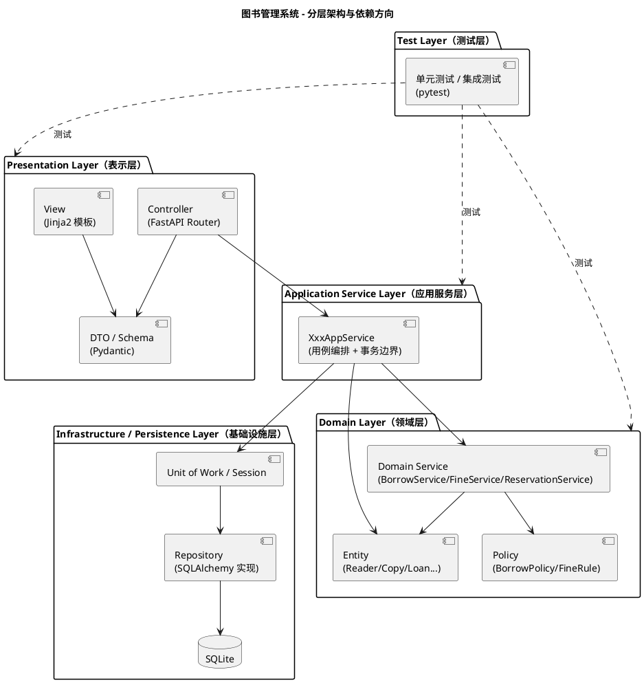
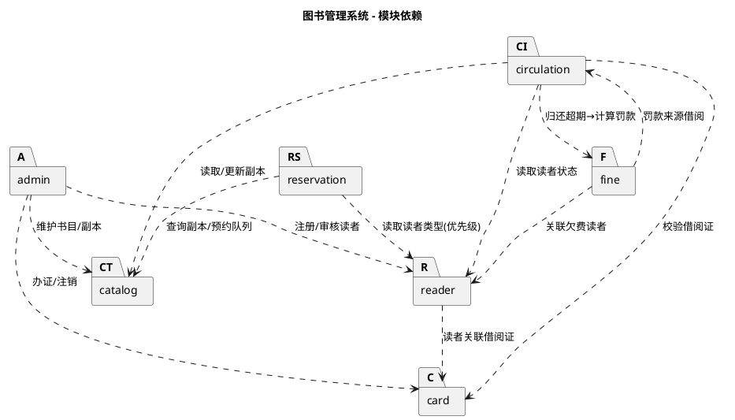

# 架构设计文档：图书管理系统

> **状态**：草稿（未经人工审查）
> **说明**：本内容由 Agent 生成，未经人工审查，不得直接作为实现依据。
> **依据**：`specs/02-requirements.md`（FR-001~018、BR-001~016、NFR-001~006）、`specs/05-domain-model.md`、`specs/constitution.md`（第 7~10 条）

---

## 一、架构概述

### 1.1 技术栈

依据 NFR-006，系统采用以下技术栈：

| 层次 | 技术选型 |
| --- | --- |
| 后端框架 | FastAPI（Python） |
| 前端视图 | 纯 HTML + Jinja2 模板 |
| ORM | SQLAlchemy |
| 数据库 | SQLite（生产）/ SQLite 内存库（测试，NFR-005） |
| 测试 | pytest（覆盖率 ≥ 70%，NFR-005） |
| 数据校验/序列化 | Pydantic（DTO/Schema） |

### 1.2 总体架构风格

系统遵循 `constitution.md` 第 7 条「分层架构 + MVC」，采用**自顶向下的单向依赖**：

- 上层可依赖下层，下层**禁止**依赖上层；
- 相邻层之间通过接口/抽象交互，禁止跨层直接访问（例如 Controller 不得直接操作数据库、Service 不得直接返回 ORM 实体给视图）；
- 表示层采用 **MVC 模式**：Model（DTO/领域对象）— View（Jinja2 模板）— Controller（FastAPI 路由处理器）。

### 1.3 分层依赖方向



> 依赖规则：Controller → ApplicationService → Domain → Infrastructure（Repository）。Test Layer 独立于运行时四层之上，可对任意层编写测试。

---

## 二、分层架构与各层职责

系统划分为五层，各层职责单一、边界清晰。

### 2.1 Presentation Layer / Controller Layer（表示层 / 控制器层）

**职责**：
1. **请求解析与参数校验**：接收 HTTP 请求，用 Pydantic Schema（DTO）完成**格式级**校验（必填、类型、长度），将请求数据转换为 DTO；
2. **调用应用服务**：将 DTO 交给应用服务层处理，自身不包含任何业务判断分支（`constitution.md` 第 8 条第 2 款）；
3. **响应组装**：将应用服务返回的结果 DTO 渲染为 JSON（API）或 Jinja2 模板（页面）；
4. **异常映射**：捕获下层抛出的业务异常，转换为恰当的 HTTP 状态码与响应体。

**MVC 角色对应**：
- **Controller**：FastAPI Router 中的路由处理函数（`@router.post("/loans")` 等）；
- **View**：Jinja2 模板，渲染 HTML；
- **Model**：Pydantic DTO（请求 `*Request` / 响应 `*Response`）。

**红线**：本层**禁止**出现任何业务规则（借阅上限判断、罚款计算、预约排序等），仅做「参数解析 → 调用服务 → 组装响应」。

### 2.2 Application Service Layer（应用服务层）

**职责**：
1. **用例流程编排**：一个应用服务方法对应一个用例（UC-01~18），按用例步骤编排领域服务的调用（Service Layer 模式）；
2. **事务边界管理**：声明并控制事务的开启、提交与回滚（见第六节）；
3. **权限/授权装配**：配合权限控制，将当前登录主体传递给下层（不在此层写业务规则，但负责鉴权后的操作转发）；
4. **DTO 与领域对象转换**：在接口层 DTO 与领域对象之间做映射，隔离表示层与领域层；
5. **跨领域服务协调**：当用例需要多个领域服务协作（如「归还 → 超期 → 计算罚款」）时在此层串联。

**典型类命名**：`ReaderAppService`、`CardAppService`、`CatalogAppService`、`CirculationAppService`、`ReservationAppService`、`FineAppService`、`AdminAppService`。

**边界**：本层**不含**可复用的业务规则细节（这些属于领域层），只负责「什么时候调用谁、如何保证一致性」。

### 2.3 Domain Layer（领域层）

**职责**：系统核心，承载全部业务规则与领域逻辑，不依赖任何基础设施（框架、ORM、HTTP）。包含三类要素（与 `05-domain-model.md` 一致）：

1. **实体（Entity）**：`Reader`/`StudentReader`/`TeacherReader`、`Account`、`BorrowCard`、`LibraryItem`/`Book`/`Magazine`/`Thesis`、`Copy`、`Loan`、`Reservation`、`FineRecord`。封装领域数据与内在行为（如 `Loan.renew()`、`BorrowCard.invalidate()`）；
2. **领域服务（Domain Service）**：`BorrowService`（借阅/归还/续借 + 前置校验 BR-007）、`FineService`（罚款计算 BR-008~009）、`ReservationService`（预约分配 BR-013~014）。编排跨实体流程，落位业务规则（`constitution.md` 第 8 条）；
3. **策略（Policy）**：`BorrowPolicy`（读者类型 × 借出物类型 → 限额/期限/续借）、`FineRule`（借出物类型 → 单价/上限），避免规则散落硬编码（`constitution.md` 第 8 条第 3 款）。

**边界**：本层不直接读写数据库，通过抽象的 `Repository` 接口（定义于领域层或基础设施层接口包）访问持久化；不依赖 FastAPI/HTTP。

### 2.4 Infrastructure / Persistence Layer（基础设施 / 持久化层）

**职责**：
1. **持久化实现**：以 SQLAlchemy ORM 实现 `Repository` 接口，负责领域对象的增删改查与查询映射（Repository 模式）；
2. **事务/会话管理**：提供 `UnitOfWork`/`Session` 封装，向上层暴露事务控制；
3. **技术组件**：密码加密（NFR-003）、日志记录、操作审计等横切技术实现；
4. **ORM 映射**：SQLAlchemy `Model`（表映射）与领域对象的转换。

**边界**：本层是「防腐层」，隔离领域层与具体技术（数据库、ORM、加密库）。领域层只依赖抽象接口，不感知 SQLite/SQLAlchemy 细节。

### 2.5 Test Layer（测试层）

**职责**（依据 `constitution.md` 第 10 条、NFR-005）：
1. **单元测试**：针对领域层业务规则（`BorrowPolicy` 限额/期限、`FineRule` 罚款计算、`BorrowService` 前置校验、`ReservationService` 优先级分配）编写纯内存断言；
2. **集成测试**：用 FastAPI `TestClient` + 独立 SQLite 内存库覆盖接口链路（注册、办证、借还、预约、罚款、权限）；
3. **权限测试（必测）**：越权访问被拒绝的用例必须覆盖（NFR-005）；
4. **规则覆盖**：每条核心业务规则（BR-001~014）至少一条断言用例（`constitution.md` 第 10 条第 4 款）。

**隔离策略**：测试使用独立数据库（SQLite 内存库），单元测试与集成测试分离，覆盖率达到 ≥ 70%。

---
## 三、模块划分

系统按业务域划分为 7 个模块（英文命名），每个模块纵向跨越四层，包含本域的 Controller、AppService、领域对象与 Repository。

| 模块 | 职责 | 主要需求 | 关键类（Controller / AppService / 领域对象） |
| --- | --- | --- | --- |
| **reader** | 读者注册、审核激活、读者信息维护与查询 | FR-001、FR-013 | `ReaderController` / `ReaderAppService` / `Reader`、`StudentReader`、`TeacherReader`、`Account` |
| **card** | 借阅证办理、注销、状态管理 | FR-002、FR-003、BR-006、BR-015 | `CardController` / `CardAppService` / `BorrowCard` |
| **catalog** | 图书/借出物标题维护、馆藏副本维护、图书查询 | FR-006~010 | `CatalogController` / `CatalogAppService` / `LibraryItem`、`Book`、`Magazine`、`Thesis`、`Copy` |
| **circulation** | 借阅、归还、续借、借阅信息查询 | FR-011、FR-012、FR-013、FR-017、BR-001~007 | `CirculationController` / `CirculationAppService` / `Loan`、`BorrowService`、`BorrowPolicy` |
| **reservation** | 预约发起、预约分配、预约通知、保留期管理 | FR-014、BR-011~014 | `ReservationController` / `ReservationAppService` / `Reservation`、`ReservationService` |
| **fine** | 超期罚款计算、罚款缴纳标记、罚款规则维护 | FR-015、FR-016、FR-018、BR-008~010 | `FineController` / `FineAppService` / `FineRecord`、`FineService`、`FineRule` |
| **admin** | 管理员账号管理、登录认证、规则维护入口 | FR-004、FR-005、FR-016 | `AdminController` / `AdminAppService` / `Account`（管理员侧） |

### 3.1 模块间依赖关系



> 依赖方向遵循「单向、无环」原则。`circulation` 是核心模块，汇聚 reader/card/catalog 的读取与 fine 的触发；`reservation` 与 `circulation` 通过副本状态（`Copy.status`）间接联动（副本释放触发预约分配）。

---

## 四、权限控制策略（RBAC）

### 4.1 角色定义

依据 `constitution.md` 第 9 条与需求 2.4，系统实现基于角色的访问控制：

| 角色 | 说明 | 主要权限 |
| --- | --- | --- |
| `Reader`（读者，含 `StudentReader`/`TeacherReader` 子类型） | 借阅者 | 查询图书、查询本人借阅、发起预约 |
| `Admin`（图书管理员） | 业务管理员 | 读者注册审核、办证/注销、书目与副本维护、办理借还、处理预约分配、标记罚款已缴、维护规则 |
| `SuperAdmin`（超级管理员） | 系统内置 | 创建/停用图书管理员账号 |

> 注：管理员角色划分口径存在待确认问题 P-02（单一 Admin 与「系统管理员/图书管理员」职责分离的冲突），本架构暂按「单一 `Admin` + 内置 `SuperAdmin`」设计，规则维护（FR-016）归 `Admin`。最终口径需人工确认。

### 4.2 权限实现机制

1. **集中式校验**：用 FastAPI 的 **依赖注入（Dependency）** 实现 `get_current_user`、`require_role(...)`、`require_admin` 等可复用的鉴权依赖，供各路由声明使用，避免权限逻辑在多个 Controller 中重复（`constitution.md` 第 9 条第 4 款）；
2. **接口级声明**：每个受保护路由通过依赖声明所需角色（如 `Depends(require_role("Admin"))`），后端强制校验，不依赖前端隐藏按钮（`constitution.md` 第 9 条第 2 款）；
3. **数据级鉴权**：读者查询借阅信息（FR-013）仅能查本人，由应用服务层校验「当前读者 id == 查询读者 id」，越权返回 403；
4. **敏感操作审计**：管理员维护、办证、标记罚款等敏感操作记录操作日志（NFR-003）。

### 4.3 权限边界矩阵（接口级）

| 接口 | Reader | Admin | SuperAdmin |
| --- | --- | --- | --- |
| 查询图书（FR-010） | ✓ | ✓ | — |
| 查询本人借阅信息（FR-013） | ✓（仅本人） | ✓（任意） | — |
| 发起预约（FR-014） | ✓ | — | — |
| 注册/审核读者（FR-001） | — | ✓ | — |
| 办理/注销借阅证（FR-002/003） | — | ✓ | — |
| 维护书目/副本（FR-006~009） | — | ✓ | — |
| 办理借还/续借（FR-011/012/017） | — | ✓ | — |
| 处理预约分配（FR-014） | — | ✓ | — |
| 标记罚款已缴（FR-018） | — | ✓ | — |
| 维护规则（FR-016） | — | ✓ | — |
| 添加/删除管理员（FR-004/005） | — | — | ✓ |

---

## 五、异常处理策略

### 5.1 异常体系

系统定义统一的业务异常基类，并派生语义化子类，实现「业务异常 → 错误码 → HTTP 状态码」的稳定映射：

| 异常类型 | 含义 | HTTP 状态码 | 错误码示例 |
| --- | --- | --- | --- |
| `DomainException`（基类） | 所有业务异常的根 | — | — |
| `BusinessRuleViolation` | 业务规则不满足（BR-001~016） | 422 / 409 | `BR-001-EXCEED_LIMIT` |
| `NotFoundException` | 目标不存在（标题、副本、读者） | 404 | `NOT_FOUND` |
| `ConflictException` | 资源冲突（ISBN 重复、副本号重复、并发冲突） | 409 | `DUPLICATE_ISBN` |
| `UnauthorizedException` | 未认证 | 401 | `UNAUTHORIZED` |
| `ForbiddenException` | 越权访问 | 403 | `FORBIDDEN` |
| `ValidationException` | 参数格式非法 | 422 | `VALIDATION_ERROR` |

### 5.2 处理策略

1. **全局异常处理器**：在 FastAPI 注册统一的 `exception_handler`，集中将 `DomainException` 及其子类转换为结构化错误响应（含错误码、中文提示、可选字段），Controller 不逐处 try/except；
2. **业务提示映射**：各业务规则的拒绝提示（如「已达借阅上限」「存在未缴罚款」）在领域层抛出时携带语义消息，由全局处理器原样透出给前端；
3. **未预期异常兜底**：捕获 `Exception` 兜底返回 500，并记录日志，不向客户端泄露内部堆栈；
4. **边界校验前置**：请求进入 Controller 前由 Pydantic 完成格式校验，格式错误直接返回 422，不进入领域层。

---

## 六、事务边界与并发控制

### 6.1 事务边界

1. **事务定义位置**：事务边界统一落在**应用服务层**（Application Service Layer），一个用例方法对应一个事务（`UnitOfWork`/`Session` 上下文）；
2. **原子性用例**：以下用例必须作为单一事务提交/回滚（NFR-002）：
   - **借阅**（FR-011）：副本置「借出」+ 创建 `Loan` 必须同时成功；
   - **归还**（FR-012）：副本置「在架」+ `Loan` 标记归还 + 可能的 `FineRecord` 生成必须一致；
   - **续借**（FR-017）：`Loan.dueDate` 顺延 + `renewed` 标记原子；
   - **预约分配**（FR-014）：副本置「预约保留」+ `Reservation` 置「已分配」原子；
   - **标记罚款已缴**（FR-018）：`FineRecord` 置已缴 + 欠费状态清零原子。
3. **只读用例**：查询类（FR-010、FR-013）在只读会话中执行，不开启写事务。

### 6.2 并发控制（NFR-002）

1. **副本竞争**：对同一 `Copy` 的借阅/预约分配存在并发竞争，采用**乐观锁（版本号 `version` 字段）**或**悲观锁（`SELECT ... FOR UPDATE`）**保证一致性，冲突时抛出 `ConflictException` 提示「副本不可借」；
2. **预约队列**：同一 `LibraryItem` 的预约分配在事务内串行化处理，避免重复分配同一副本；
3. **一致性保证**：借阅/归还的副本状态与借阅记录通过同一事务保证强一致，杜绝「副本已借出但无借阅记录」的半成品状态。

---

## 七、业务规则落位

依据 `constitution.md` 第 8 条「业务规则必须落在业务层 Service，严禁写入 Controller」，各业务规则落位如下：

| 业务规则 | 落位类 | 说明 |
| --- | --- | --- |
| BR-001 读者类型限额/期限 | `BorrowPolicy` | `baseMaxCount(readerType)`、`baseLoanPeriod(readerType)` |
| BR-002 续借规则 | `BorrowPolicy` + `Loan.renew()` | `canRenew(itemType)`；论文不可续借 |
| BR-003 借出物类型限制 | `BorrowPolicy` | 外文减半、杂志 7 天、论文 3 天 |
| BR-004 限额叠加取严 | `BorrowPolicy` | `effectiveMaxCount(readerType, itemType)` |
| BR-005 同标题限借 1 本 | `BorrowService`（前置校验） | 校验读者是否已借同 `LibraryItem` |
| BR-006 借阅证有效性 | `BorrowCard.isValid()` + `BorrowService` | 校验证件状态 |
| BR-007 借阅前置校验 | `BorrowService.borrow()` | 证有效、未达上限、无超期、无欠费 |
| BR-008 超期罚款单价 | `FineRule` | `ratePerDay(itemType)` |
| BR-009 罚款上限 | `FineRule` | `calculateFine` 内 `min(rate×N, 20)` |
| BR-010 罚款挂账/追缴 | `FineService` + `BorrowService` | 归还挂账、借阅时校验欠费 |
| BR-011 预约触发条件 | `ReservationService` | 所有副本均借出方可预约 |
| BR-012 预约上限/限制 | `ReservationService` | 上限 3、已借不可约 |
| BR-013 预约优先级 | `ReservationService.allocate()` | 教师 > 博士 > 硕士 > 本科 > 专科，同级先到先得 |
| BR-014 通知/保留期 | `ReservationService` | 7 天保留，站内消息 |
| BR-015 账号-读者-证一对一 | `ReaderAppService` / `CardAppService` | 创建时唯一性校验 |
| BR-016 历史保留 | Repository 层 | 逻辑删除/状态标记，不物理删除 |

**原则**：
- 数值型规则（限额、期限、单价、上限）**只**存在于 `BorrowPolicy` / `FineRule`，不散落于 Controller 或其它服务（`constitution.md` 第 8 条第 3 款）；
- 流程型规则（前置校验、分配顺序、状态流转）存在于领域服务 `BorrowService` / `FineService` / `ReservationService`；
- 状态流转的内在不变量（如 `Loan` 的 `borrowDate ≤ dueDate`）由实体自身方法保证。

---

## 八、设计模式

| 设计模式 | 应用位置 | 说明 |
| --- | --- | --- |
| **Strategy（策略）** | `BorrowPolicy`、`FineRule` | 不同读者类型的借阅限额/期限、不同借出物类型的罚款单价/上限，通过策略对象按「读者类型 × 借出物类型」查询，规则可被管理员维护（FR-016），新增规则无需改动调用方 |
| **Factory（工厂）** | `ReaderFactory`、`LibraryItemFactory` | 按读者类型创建 `StudentReader`/`TeacherReader`（FR-001），按借出物类型创建 `Book`/`Magazine`/`Thesis`（FR-006），将对象构造与使用解耦 |
| **Repository（仓库）** | 基础设施层 `*Repository` | 封装领域对象的持久化，领域层只依赖 `Repository` 接口，隔离 ORM/数据库细节 |
| **Service Layer（服务层）** | `*AppService`（应用服务） | 组织用例流程、声明事务边界、串联多个领域服务，隔离表示层与领域层 |
| **DTO（数据传输对象）** | Pydantic `*Request` / `*Response` | 隔离接口层与领域层，避免领域实体直接暴露给视图/网络，保证类型安全 |
| **MVC（模型-视图-控制器）** | 表示层 | Controller（FastAPI 路由）分离界面与业务，View（Jinja2）负责呈现，Model（DTO）承载数据 |

**组合说明**：`Strategy` + `Factory` 共同支撑「多读者类型 × 多借出物类型」的可扩展规则体系；`Repository` + `Service Layer` + `DTO` 共同落实分层边界与单向依赖，避免跨层泄漏。

---

## 九、目录（包）结构建议

遵循分层 + 模块组织，包结构示意（模块名与类名英文）：

```
library-management/
├── app/
│   ├── presentation/            # 表示层
│   │   ├── controllers/         # FastAPI Router（reader/card/catalog/...）
│   │   ├── schemas/             # Pydantic DTO（*Request / *Response）
│   │   └── templates/           # Jinja2 视图
│   ├── application/             # 应用服务层
│   │   ├── reader_app_service.py
│   │   ├── circulation_app_service.py
│   │   └── ...
│   ├── domain/                  # 领域层
│   │   ├── entities/            # Reader/Copy/Loan/...
│   │   ├── services/            # BorrowService/FineService/ReservationService
│   │   ├── policies/            # BorrowPolicy/FineRule
│   │   ├── factories/           # ReaderFactory/LibraryItemFactory
│   │   └── repositories/        # Repository 抽象接口
│   ├── infrastructure/          # 基础设施层
│   │   ├── orm/                 # SQLAlchemy Model 映射
│   │   ├── repositories/        # Repository 实现
│   │   ├── uow.py               # UnitOfWork/会话管理
│   │   └── security.py          # 密码加密、鉴权依赖
│   └── main.py                  # 应用入口、异常处理器注册
└── tests/                       # 测试层
    ├── unit/                    # 领域规则单元测试
    └── integration/             # 接口链路集成测试
```

---

## 十、人工审查要点对照

1. **是否采用分层架构与 MVC？** 是（五层 + MVC，见第一、二章）。
2. **各层职责是否单一？** 是（Controller 不做业务、Service 落业务规则、Repository 管持久化，见第二章）。
3. **7 个模块是否齐全？** 是（reader/card/catalog/circulation/reservation/fine/admin，见第三章）。
4. **权限控制是否后端强制？** 是（依赖注入 + 接口级声明，见第四章）。
5. **业务规则是否落在 Service/领域层而非 Controller？** 是（见第七章）。
6. **是否使用建议的设计模式？** 是（Strategy/Factory/Repository/ServiceLayer/DTO/MVC，见第八章）。