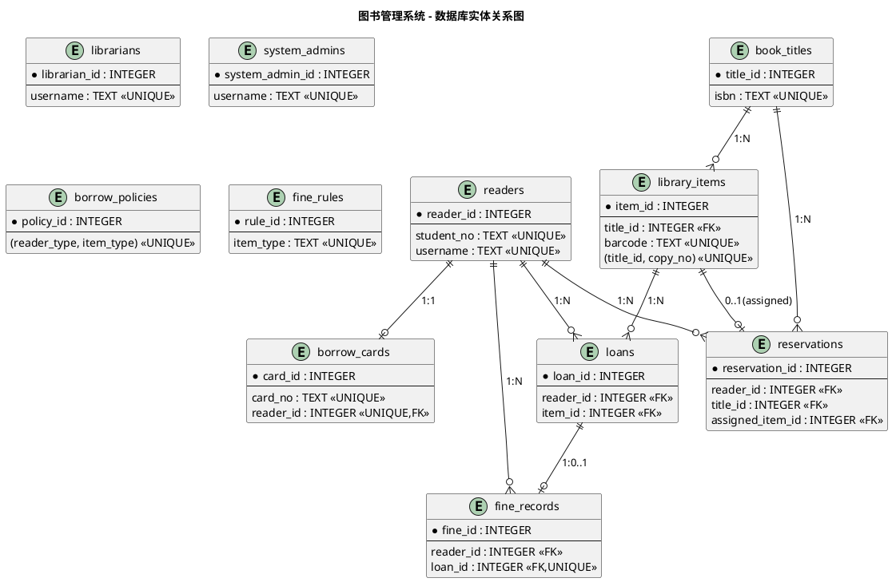

# 数据库设计文档：图书管理系统

> **状态**：草稿（未经人工审查）
> **说明**：本内容由 Agent 生成，未经人工审查，不得直接作为实现依据。
> **依据**：`specs/05-domain-model.md`（领域模型）、`specs/07-architecture.md`（架构设计）、`specs/02-requirements.md`（FR-001~018、BR-001~016）、`specs/constitution.md`（第 8 条第 4 款：数据库约束与业务规则分层配置）

---

## 一、概述

### 1.1 文档目的

本文档将 `05-domain-model.md` 中识别的领域实体与策略对象转换为关系数据库模型，给出表结构、约束、索引与继承映射策略，作为基础设施层（SQLAlchemy ORM 映射）与 Repository 实现的唯一事实来源。

### 1.2 技术栈与数据库选型

依据 `07-architecture.md` 第 1.1 节与 NFR-006：

| 项 | 选型 |
| --- | --- |
| 数据库 | SQLite（生产）/ SQLite 内存库（测试） |
| ORM | SQLAlchemy |
| 类型映射 | SQLAlchemy 逻辑类型映射到 SQLite 存储类型 |

### 1.3 命名约定

- 表名、字段名统一采用英文 `snake_case`，表名用复数（与 `07-architecture.md` 及需求表清单一致）。
- 主键命名为 `<表名单数>_id`（如 `reader_id`），采用整数自增（SQLite `INTEGER PRIMARY KEY`）。
- 外键命名为「被引用表名 + `_id`」，与主键同名，便于联表。
- 业务规则引用沿用需求编号（BR-001、FR-001 等）。

### 1.4 逻辑类型与 SQLite 存储类型对照

| 逻辑类型 | SQLAlchemy 类型 | SQLite 存储 | 说明 |
| --- | --- | --- | --- |
| INTEGER | `Integer` | INTEGER | 主键、计数、年份 |
| BOOLEAN | `Boolean` | INTEGER (0/1) | 布尔字段 |
| TEXT | `String` / `Text` | TEXT | 字符串、枚举（存字符串常量） |
| NUMERIC(10,2) | `Numeric(10,2)` | REAL/NUMERIC | 金额，应用层用 `Decimal` 计算避免浮点误差 |
| DATE | `Date` | TEXT ('YYYY-MM-DD') | 日期 |
| DATETIME | `DateTime` | TEXT (ISO8601) | 时间戳 |

> **金额精度提示**：罚款单价（0.1/0.2/0.5/1.0）与罚款金额（上限 20）涉及小数，应用层统一用 `Decimal` 计算，避免 `float` 浮点误差（BR-008/BR-009）。

---

## 二、需要持久化的领域类识别

依据 `05-domain-model.md` 第 5 章「类型归类小结」，需要持久化的领域类与对应的数据库表如下：

| 领域类（05-domain-model.md） | 类型 | 是否持久化 | 对应表 |
| --- | --- | --- | --- |
| `Reader`（抽象）、`StudentReader`、`TeacherReader` | 实体 | 是 | `readers`（单表继承合并） |
| `Account` | 实体 | 是（并入读者/管理员账号） | `readers` / `librarians` / `system_admins` |
| `BorrowCard` | 实体 | 是 | `borrow_cards` |
| `LibraryItem`（抽象）、`Book`、`Magazine`、`Thesis` | 实体 | 是（单表继承合并） | `book_titles` |
| `Copy` | 实体 | 是 | `library_items` |
| `Loan` | 实体 | 是 | `loans` |
| `Reservation` | 实体 | 是 | `reservations` |
| `FineRecord` | 实体 | 是 | `fine_records` |
| `BorrowPolicy` | 策略 | 是（规则数据需维护） | `borrow_policies` |
| `FineRule` | 策略 | 是（规则数据需维护） | `fine_rules` |
| `BorrowService` / `FineService` / `ReservationService` | 领域服务 | 否（无状态） | — |

> **说明 1（管理员账号建模）**：领域模型与架构文档将管理员角色表述为「图书管理员（Admin）+ 超级管理员（SuperAdmin）」（`07-architecture.md` 第 4.1 节，且标注待确认问题 P-02）。需求表清单要求 `librarians` 与 `system_admins` 两张表，本设计据此将管理员侧的 `Account` 凭据分别落在 `librarians` 与 `system_admins` 两张独立表中，并保留 P-02 待人工确认标记。
>
> **说明 2（读者账号合并）**：领域模型 `Account` 与 `Reader` 一对一（BR-015），为避免 1:1 冗余外键与额外联表，将读者账号凭据（`username` / `password` / `account_status`）合并进 `readers` 表。

---

## 三、领域继承到关系数据库的映射策略

`05-domain-model.md` 中存在两处继承体系与若干关联关系，映射策略如下：

### 3.1 继承映射：单表继承（Single Table Inheritance）

| 继承体系 | 映射方式 | 鉴别列 | 表 | 理由 |
| --- | --- | --- | --- | --- |
| `Reader` ← `StudentReader` / `TeacherReader` | 单表继承 | `reader_type` | `readers` | 子类属性差异小（`TeacherReader` 无特有属性），单表避免多表 join，简化 Repository |
| `LibraryItem` ← `Book` / `Magazine` / `Thesis` | 单表继承 | `item_type` | `book_titles` | 三类共享 `title`/`author` 等公共书目属性，特有属性（ISBN/ISSN/期号等）以可空列承载 |

**子类特有属性处理**：子类独有属性在表中以「可空列」表示，仅当 `item_type` 取对应取值时填写，其余情况为 NULL。例如 `isbn` 仅在 `item_type = 'Book'` 时非空。

**鉴别列取值**（见第八章枚举）：
- `readers.reader_type`：`Undergraduate` / `Graduate` / `Doctoral` / `JuniorCollege` / `Teacher`
- `book_titles.item_type`：`Book` / `Magazine` / `Thesis`

> **简化说明**：`05-domain-model.md` 中 `Reader.readerType`（5 类）与 `StudentReader.studentType`（4 类）取值重叠，属领域模型冗余。数据库设计以单一鉴别列 `reader_type`（5 类）区分全部读者，不再引入冗余的 `student_type` 列。

### 3.2 关联关系映射

| 领域关系 | 关系模型表达 |
| --- | --- |
| `Reader` 1:1 `Account` | `Account` 凭据合并入 `readers`（见说明 2） |
| `Reader` 1:1 `BorrowCard` | `borrow_cards.reader_id` 加 `UNIQUE` 约束 |
| `Reader` 1:N `Loan` / `Reservation` / `FineRecord` | 子表外键 `reader_id` 指向 `readers` |
| `LibraryItem` 1:N `Copy` | `library_items.title_id` 外键指向 `book_titles` |
| `LibraryItem` 1:N `Reservation` | `reservations.title_id` 外键指向 `book_titles` |
| `Copy` 1:N `Loan` | `loans.item_id` 外键指向 `library_items` |
| `Loan` 1:0..1 `FineRecord` | `fine_records.loan_id` 外键 + `UNIQUE` 约束 |

**多对多**：本系统无多对多关系，无需关联表。

### 3.3 策略对象映射

`BorrowPolicy`、`FineRule` 属策略对象（非继承），映射为普通配置表，按「维度键」逐行存储规则：

- `borrow_policies`：以 `(reader_type, item_type)` 联合维度为行键（`UNIQUE`）。
- `fine_rules`：以 `item_type` 为行键（`UNIQUE`）。

规则由管理员维护（FR-016），新规则只影响新发生的借阅（`07-architecture.md` 第 7 节）。

---

## 四、关系模型总体设计

### 4.1 表清单总览

| # | 表名 | 对应领域类 | 主键 | 说明 |
| --- | --- | --- | --- | --- |
| 1 | `readers` | `Reader` / `StudentReader` / `TeacherReader` + `Account` | `reader_id` | 读者及账号 |
| 2 | `borrow_cards` | `BorrowCard` | `card_id` | 借阅证 |
| 3 | `librarians` | `Account`（管理员侧） | `librarian_id` | 图书管理员账号 |
| 4 | `system_admins` | `Account`（管理员侧） | `system_admin_id` | 系统管理员账号 |
| 5 | `book_titles` | `LibraryItem` / `Book` / `Magazine` / `Thesis` | `title_id` | 借出物书目标题 |
| 6 | `library_items` | `Copy` | `item_id` | 馆藏副本（物理册） |
| 7 | `loans` | `Loan` | `loan_id` | 借阅记录 |
| 8 | `reservations` | `Reservation` | `reservation_id` | 预约记录 |
| 9 | `borrow_policies` | `BorrowPolicy` | `policy_id` | 借阅规则 |
| 10 | `fine_rules` | `FineRule` | `rule_id` | 罚款规则 |
| 11 | `fine_records` | `FineRecord` | `fine_id` | 罚款记录 |

### 4.2 实体关系图（PlantUML）

---

## 五、表结构详细设计

> 表格列说明：**可空**（`否`=NOT NULL，`是`=可 NULL）；**主键/外键/唯一/默认** 列合并标注约束类型。

### 5.1 readers（读者表）

对应 `Reader` / `StudentReader` / `TeacherReader` + `Account`（单表继承，账号合并）。

| 字段名 | 类型 | 可空 | 主键/外键/唯一/默认值 | 说明 |
| --- | --- | --- | --- | --- |
| `reader_id` | INTEGER | 否 | 主键（自增） | 读者系统标识 |
| `student_no` | TEXT | 否 | 唯一 | 学号（学生）/工号（教师），FR-001 必填、唯一 |
| `name` | TEXT | 否 | — | 姓名 |
| `contact` | TEXT | 否 | — | 联系方式（手机/邮箱） |
| `reader_type` | TEXT | 否 | 鉴别列 | 读者类型：Undergraduate/Graduate/Doctoral/JuniorCollege/Teacher |
| `account_status` | TEXT | 否 | 默认 `'Pending'` | 账号状态：Pending/Active/Disabled |
| `active` | BOOLEAN | 否 | 默认 `1` | 在校/在职状态（判断借阅证是否应失效，BR-006） |
| `username` | TEXT | 否 | 唯一 | 登录名（Account.username） |
| `password` | TEXT | 否 | — | 密码（加密存储，NFR-003） |

### 5.2 borrow_cards（借阅证表）

对应 `BorrowCard`。

| 字段名 | 类型 | 可空 | 主键/外键/唯一/默认值 | 说明 |
| --- | --- | --- | --- | --- |
| `card_id` | INTEGER | 否 | 主键（自增） | 借阅证系统标识 |
| `card_no` | TEXT | 否 | 唯一 | 借阅证号（办理时生成，FR-002） |
| `reader_id` | INTEGER | 否 | 外键→`readers.reader_id`，唯一 | 关联读者，1:1（BR-015） |
| `status` | TEXT | 否 | 默认 `'Active'` | 状态：Active/Invalid |
| `issue_date` | DATE | 否 | 默认当天 | 办理日期 |

### 5.3 librarians（图书管理员表）

对应管理员侧 `Account`（图书管理员，P-02 待确认）。

| 字段名 | 类型 | 可空 | 主键/外键/唯一/默认值 | 说明 |
| --- | --- | --- | --- | --- |
| `librarian_id` | INTEGER | 否 | 主键（自增） | 图书管理员系统标识 |
| `username` | TEXT | 否 | 唯一 | 登录名 |
| `password` | TEXT | 否 | — | 密码（加密存储，NFR-003） |
| `name` | TEXT | 否 | — | 姓名 |
| `status` | TEXT | 否 | 默认 `'Active'` | 状态：Active/Disabled |

### 5.4 system_admins（系统管理员表）

对应管理员侧 `Account`（超级管理员，FR-004/FR-005）。

| 字段名 | 类型 | 可空 | 主键/外键/唯一/默认值 | 说明 |
| --- | --- | --- | --- | --- |
| `system_admin_id` | INTEGER | 否 | 主键（自增） | 系统管理员系统标识 |
| `username` | TEXT | 否 | 唯一 | 登录名 |
| `password` | TEXT | 否 | — | 密码（加密存储，NFR-003） |
| `name` | TEXT | 否 | — | 姓名 |
| `status` | TEXT | 否 | 默认 `'Active'` | 状态：Active/Disabled |

### 5.5 book_titles（借出物书目标题表）

对应 `LibraryItem` / `Book` / `Magazine` / `Thesis`（单表继承，`item_type` 鉴别）。

| 字段名 | 类型 | 可空 | 主键/外键/唯一/默认值 | 说明 |
| --- | --- | --- | --- | --- |
| `title_id` | INTEGER | 否 | 主键（自增） | 书目标题系统标识 |
| `item_type` | TEXT | 否 | 鉴别列 | 借出物类型：Book/Magazine/Thesis |
| `title` | TEXT | 否 | — | 题名（必填） |
| `author` | TEXT | 是 | — | 作者 |
| `isbn` | TEXT | 是 | 唯一 | 国际标准书号（仅 Book，FR-006） |
| `issn` | TEXT | 是 | — | 国际标准连续出版物号（仅 Magazine） |
| `language` | TEXT | 是 | — | 语种：Chinese/Foreign（Book、Magazine） |
| `issue_no` | TEXT | 是 | — | 期号（仅 Magazine） |
| `category` | TEXT | 是 | — | 分类号（仅 Book） |
| `publisher` | TEXT | 是 | — | 出版社（仅 Book） |
| `publish_year` | INTEGER | 是 | — | 出版年（仅 Book） |
| `degree_grantor` | TEXT | 是 | — | 学位授予单位（仅 Thesis） |
| `completion_year` | INTEGER | 是 | — | 完成年份（仅 Thesis） |

### 5.6 library_items（馆藏副本表）

对应 `Copy`。

| 字段名 | 类型 | 可空 | 主键/外键/唯一/默认值 | 说明 |
| --- | --- | --- | --- | --- |
| `item_id` | INTEGER | 否 | 主键（自增） | 副本系统标识 |
| `title_id` | INTEGER | 否 | 外键→`book_titles.title_id` | 所属书目标题（1:N） |
| `barcode` | TEXT | 否 | 唯一 | 物理条码（全局唯一，扫描识别物理册） |
| `copy_no` | TEXT | 否 | 组合唯一 `(title_id, copy_no)` | 副本号（同一标题下唯一，FR-008） |
| `location` | TEXT | 是 | — | 馆藏位置 |
| `status` | TEXT | 否 | 默认 `'Available'` | 状态：Available/Borrowed/Reserved/Maintenance/Lost |

### 5.7 loans（借阅记录表）

对应 `Loan`。

| 字段名 | 类型 | 可空 | 主键/外键/唯一/默认值 | 说明 |
| --- | --- | --- | --- | --- |
| `loan_id` | INTEGER | 否 | 主键（自增） | 借阅记录系统标识 |
| `reader_id` | INTEGER | 否 | 外键→`readers.reader_id` | 借阅读者（N:1） |
| `item_id` | INTEGER | 否 | 外键→`library_items.item_id` | 借阅副本（N:1） |
| `borrow_date` | DATE | 否 | — | 借阅日期 |
| `due_date` | DATE | 否 | — | 应还日期（按 BorrowPolicy 计算） |
| `return_date` | DATE | 是 | — | 实际归还日期（归还时填写） |
| `renewed` | BOOLEAN | 否 | 默认 `0` | 是否已续借（最多 1 次，BR-002） |
| `status` | TEXT | 否 | 默认 `'Borrowed'` | 状态：Borrowed/Returned |

> **「借出/已还/超期」三态区分**：
> - **借出**：`status = 'Borrowed'`；
> - **已还**：`status = 'Returned'`（`return_date` 非空）；
> - **超期**：派生状态，不设冗余字段——`status = 'Borrowed'` 且 `(return_date ?? 当前日期) > due_date` 即超期。超期判定由 `Loan.isOverdue()`（领域层）计算，避免冗余字段与主数据不一致。

### 5.8 reservations（预约记录表）

对应 `Reservation`。

| 字段名 | 类型 | 可空 | 主键/外键/唯一/默认值 | 说明 |
| --- | --- | --- | --- | --- |
| `reservation_id` | INTEGER | 否 | 主键（自增） | 预约系统标识 |
| `reader_id` | INTEGER | 否 | 外键→`readers.reader_id` | 预约读者（N:1） |
| `title_id` | INTEGER | 否 | 外键→`book_titles.title_id` | 预约书目标题（N:1） |
| `reserve_time` | DATETIME | 否 | 默认当前时间 | 预约时间（同级先到先得排序） |
| `priority` | INTEGER | 否 | — | 优先级（由读者类型决定，BR-013，值越大越优先） |
| `status` | TEXT | 否 | 默认 `'Waiting'` | 状态：Waiting/Assigned/Fulfilled/Cancelled/Expired |
| `expire_time` | DATETIME | 是 | — | 保留截止时间（分配后 7 天，BR-014） |
| `assigned_item_id` | INTEGER | 是 | 外键→`library_items.item_id` | 分配到的副本（分配后填写） |

> **排队支持**：同一 `title_id` 下 `status = 'Waiting'` 的预约构成等待队列，按 `priority DESC, reserve_time ASC` 排序（BR-013 优先级 + 先到先得）。

### 5.9 borrow_policies（借阅规则表）

对应 `BorrowPolicy`。

| 字段名 | 类型 | 可空 | 主键/外键/唯一/默认值 | 说明 |
| --- | --- | --- | --- | --- |
| `policy_id` | INTEGER | 否 | 主键（自增） | 规则系统标识 |
| `reader_type` | TEXT | 否 | 组合唯一 `(reader_type, item_type)` | 读者类型 |
| `item_type` | TEXT | 否 | 组合唯一 `(reader_type, item_type)` | 借出物类型 |
| `max_count` | INTEGER | 否 | — | 借阅数量上限 |
| `loan_period_days` | INTEGER | 否 | — | 借阅期限（天） |
| `renewable` | BOOLEAN | 否 | 默认 `1` | 是否可续借 |
| `count_toward_limit` | BOOLEAN | 否 | 默认 `1` | 是否计入图书限额（杂志不计，BR-003） |

> **维度说明**：`(reader_type, item_type)` 联合唯一，支持「不同读者类型 × 不同借出物类型」的差异化规则（BR-001/BR-003/BR-004），管理员可逐格维护（FR-016）。

### 5.10 fine_rules（罚款规则表）

对应 `FineRule`。

| 字段名 | 类型 | 可空 | 主键/外键/唯一/默认值 | 说明 |
| --- | --- | --- | --- | --- |
| `rule_id` | INTEGER | 否 | 主键（自增） | 规则系统标识 |
| `item_type` | TEXT | 否 | 唯一 | 借出物类型（Book/Magazine/Thesis 及其语种细分） |
| `rate_per_day` | NUMERIC(10,2) | 否 | — | 每日罚款单价（元/天，BR-008） |
| `max_fine` | NUMERIC(10,2) | 否 | 默认 `20.00` | 单册罚款上限（元，BR-009） |

> **维度说明**：`item_type` 唯一，支持不同借出物类型差异化罚款单价（中文图书 0.1、外文图书 0.2、杂志 0.5、论文 1.0，BR-008）。外文/中文图书因单价不同，需用 `item_type` 的细分取值区分（见第八章枚举）。

### 5.11 fine_records（罚款记录表）

对应 `FineRecord`。

| 字段名 | 类型 | 可空 | 主键/外键/唯一/默认值 | 说明 |
| --- | --- | --- | --- | --- |
| `fine_id` | INTEGER | 否 | 主键（自增） | 罚款系统标识 |
| `reader_id` | INTEGER | 否 | 外键→`readers.reader_id` | 欠费读者（N:1） |
| `loan_id` | INTEGER | 否 | 外键→`loans.loan_id`，唯一 | 罚款来源借阅（1:0..1） |
| `amount` | NUMERIC(10,2) | 否 | — | 罚款金额（≤ 单册上限，BR-009） |
| `status` | TEXT | 否 | 默认 `'Unpaid'` | 状态：Unpaid/Paid |
| `paid_time` | DATETIME | 是 | — | 缴纳时间（标记已缴时填写，FR-018） |
| `created_at` | DATETIME | 否 | 默认当前时间 | 罚款产生时间 |

---

## 六、外键与关系约束总览

依据 `constitution.md` 第 8 条第 4 款，数据库约束（唯一、外键、非空）与业务规则分层配置：本表只列**结构性约束**（引用完整性、唯一性），业务规则（限额、超期、预约优先级等）落在领域层 `BorrowPolicy` / `FineRule` / `BorrowService` 等，不依赖数据库触发器。

| 子表（外键所在） | 外键列 | 引用表/列 | 约束类型 | 语义 |
| --- | --- | --- | --- | --- |
| `borrow_cards` | `reader_id` | `readers.reader_id` | FK + UNIQUE | 读者 1:1 借阅证（BR-015） |
| `library_items` | `title_id` | `book_titles.title_id` | FK | 标题 1:N 副本 |
| `loans` | `reader_id` | `readers.reader_id` | FK | 读者 1:N 借阅 |
| `loans` | `item_id` | `library_items.item_id` | FK | 副本 1:N 借阅 |
| `reservations` | `reader_id` | `readers.reader_id` | FK | 读者 1:N 预约 |
| `reservations` | `title_id` | `book_titles.title_id` | FK | 标题 1:N 预约 |
| `reservations` | `assigned_item_id` | `library_items.item_id` | FK（可空） | 预约分配副本 0..1 |
| `fine_records` | `reader_id` | `readers.reader_id` | FK | 读者 1:N 罚款 |
| `fine_records` | `loan_id` | `loans.loan_id` | FK + UNIQUE | 借阅 1:0..1 罚款 |

**外键启用说明**：SQLite 默认不强制外键，需在连接时执行 `PRAGMA foreign_keys = ON`（SQLAlchemy 通过 `event.listens_for(Engine, "connect")` 开启），并在应用层 `Repository` 中维护关系完整性。业务删除采用逻辑删除/状态标记（如 `borrow_cards.status = 'Invalid'`、`library_items.status`），历史记录不物理删除（BR-016）。

---

## 七、索引设计

> 主键（自增整型）与 `UNIQUE` 约束在 SQLite 中自动创建索引，下表仅列出除主键、唯一约束外的**显式二级索引**及关键唯一约束。

| 表 | 索引列 | 类型 | 理由 |
| --- | --- | --- | --- |
| `readers` | `student_no` | 唯一索引 | FR-001 学号/工号唯一校验 |
| `readers` | `username` | 唯一索引 | 登录名唯一 |
| `borrow_cards` | `card_no` | 唯一索引 | 借阅证号唯一（审查重点 1） |
| `borrow_cards` | `reader_id` | 唯一索引 | 1:1 关联，按读者查证 |
| `librarians` | `username` | 唯一索引 | 登录名唯一 |
| `system_admins` | `username` | 唯一索引 | 登录名唯一 |
| `book_titles` | `isbn` | 唯一索引（可空） | ISBN 唯一（FR-006） |
| `book_titles` | `title` | 普通索引 | 按题名前缀查询（FR-010） |
| `library_items` | `barcode` | 唯一索引 | 条码全局唯一（审查重点 2） |
| `library_items` | `(title_id, copy_no)` | 组合唯一索引 | 副本号同一标题下唯一（FR-008） |
| `library_items` | `title_id` | 普通索引 | 按标题查副本（FR-010） |
| `loans` | `reader_id` | 普通索引 | 按读者查借阅（FR-013） |
| `loans` | `item_id` | 普通索引 | 按副本查借阅 |
| `loans` | `(reader_id, status)` | 组合索引 | 查询当前在借记录（BR-007 前置校验） |
| `reservations` | `reader_id` | 普通索引 | 按读者查预约 |
| `reservations` | `(title_id, status, priority, reserve_time)` | 组合索引 | 预约队列排序（BR-013） |
| `fine_records` | `reader_id` | 普通索引 | 按读者查欠费（BR-010/FR-013） |
| `fine_records` | `loan_id` | 唯一索引 | 1:0..1 关联 |
| `borrow_policies` | `(reader_type, item_type)` | 组合唯一索引 | 规则精确查询（FR-016） |
| `fine_rules` | `item_type` | 唯一索引 | 规则精确查询 |

**索引原则**：
1. 为高频查询外键列（`reader_id`、`title_id`、`item_id`）建普通索引；
2. 为业务唯一性（证号、学号、条码、ISBN、登录名）建唯一索引；
3. 为预约队列排序、在借查询等复合条件建组合索引，避免排序全表扫描；
4. 控制索引数量，避免对低基数列（如 `status` 单独列）过度建索引。

---

## 八、枚举取值与默认值约定

| 字段 | 枚举取值（存储值） | 含义 |
| --- | --- | --- |
| `readers.reader_type` | `Undergraduate` / `Graduate` / `Doctoral` / `JuniorCollege` / `Teacher` | 本科生/研究生/博士生/专科生/教师 |
| `readers.account_status` | `Pending` / `Active` / `Disabled` | 待激活/已激活/已停用 |
| `borrow_cards.status` | `Active` / `Invalid` | 有效/已失效 |
| `librarians.status` / `system_admins.status` | `Active` / `Disabled` | 启用/停用 |
| `book_titles.item_type` | `Book` / `Magazine` / `Thesis` | 图书/杂志/论文 |
| `book_titles.language` | `Chinese` / `Foreign` | 中文/外文 |
| `library_items.status` | `Available` / `Borrowed` / `Reserved` / `Maintenance` / `Lost` | 在架/借出/预约保留/维护中/丢失 |
| `loans.status` | `Borrowed` / `Returned` | 借出/已归还 |
| `reservations.status` | `Waiting` / `Assigned` / `Fulfilled` / `Cancelled` / `Expired` | 等待中/已分配/已取书/已取消/已过期 |
| `reservations.priority` | `5`(教师) > `4`(博士生) > `3`(研究生) > `2`(本科生) > `1`(专科生) | 值越大优先级越高（BR-013） |
| `fine_records.status` | `Unpaid` / `Paid` | 未缴/已缴 |

> **罚款规则 `fine_rules.item_type` 细分取值**：因中文图书与外文图书罚款单价不同（BR-008：0.1 vs 0.2），`item_type` 需进一步细分语种维度。建议取值：`Book_Chinese`（0.1）、`Book_Foreign`（0.2）、`Magazine`（0.5）、`Thesis`（1.0）。此细分维度与 `book_titles.item_type` + `language` 的组合对应，由 `FineRule` 策略在应用层映射，具体取值口径需人工确认。

---

## 九、初始种子数据

系统首次运行时需预置以下数据（策略规则 + 内置超级管理员）：

1. **系统管理员**：`system_admins` 预置一条超级管理员账号（FR-004，防止系统无管理员入口，FR-005 禁止停用最后一个）。
2. **借阅规则 `borrow_policies`**（BR-001/BR-003 预置种子）：
   - 读者类型基础限额：专科生 3/30 天、本科生 5/30 天、研究生 8/60 天、博士生 10/60 天、教师 15/90 天；
   - 借出物类型限制：外文图书限额/期限减半、杂志 7 天且不计限额（`count_toward_limit=0`）、论文 3 天且不可续借（`renewable=0`）。
3. **罚款规则 `fine_rules`**（BR-008/BR-009）：中文图书 0.1、外文图书 0.2、杂志 0.5、论文 1.0（单位：元/天），上限均 20 元。

---

## 十、人工审查重点对照

| # | 审查重点 | 结论 | 落位 |
| --- | --- | --- | --- |
| 1 | `borrow_card.card_no` 是否唯一？ | 是 | `borrow_cards.card_no` 加 `UNIQUE` 唯一索引 |
| 2 | `library_item.barcode` 是否唯一？ | 是 | `library_items.barcode` 加 `UNIQUE` 唯一索引（全局唯一）；另有 `(title_id, copy_no)` 组合唯一约束 |
| 3 | `loans` 能否区分借出、已还、超期？ | 是 | `status`（Borrowed/Returned）区分借出/已还；超期为派生状态，由 `due_date` 与 `return_date`（或当前日期）比较判定 |
| 4 | `reservations` 能否支持排队？ | 是 | 同一 `title_id` 下按 `priority DESC, reserve_time ASC` 排序构成等待队列，并配 `(title_id, status, priority, reserve_time)` 组合索引 |
| 5 | `fine_rules` 能否支持不同借出物类型？ | 是 | `item_type` 为唯一维度键，支持不同借出物类型（含语种细分）差异化单价 |
| 6 | `borrow_policies` 能否支持不同读者类型？ | 是 | `(reader_type, item_type)` 联合唯一，支持不同读者类型 × 借出物类型组合 |
| 7 | 是否存在必要外键？ | 是 | 共 9 处外键（见第六章），覆盖读者-证/借阅/预约/罚款、标题-副本/预约、副本-借阅/预约分配、借阅-罚款等全部关联 |

---

## 十一、待确认问题

1. **P-02 管理员角色划分**：`librarians` 与 `system_admins` 是否拆分，取决于管理员角色口径（见 `02-requirements.md` P-02），本设计按需求表清单拆分，需人工确认。
2. **P-03 杂志/论文借阅上限**：`borrow_policies.max_count` 对杂志/论文的取值是否另设独立上限，需人工确认后填充种子数据。
3. **`fine_rules.item_type` 语种细分取值**：中文图书与外文图书罚款单价不同，`item_type` 的细分取值口径（如 `Book_Chinese`/`Book_Foreign`）需人工确认。